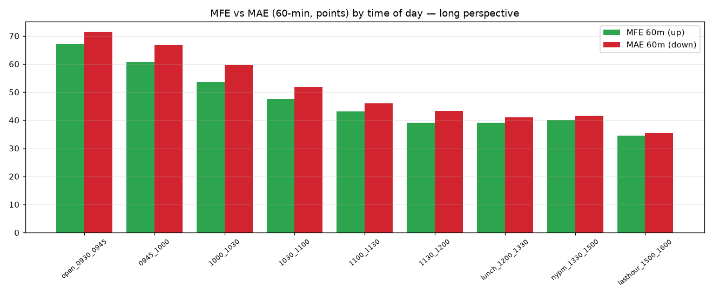
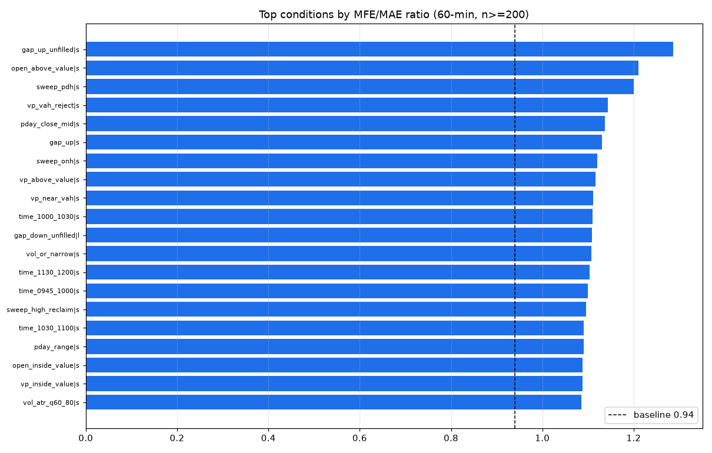
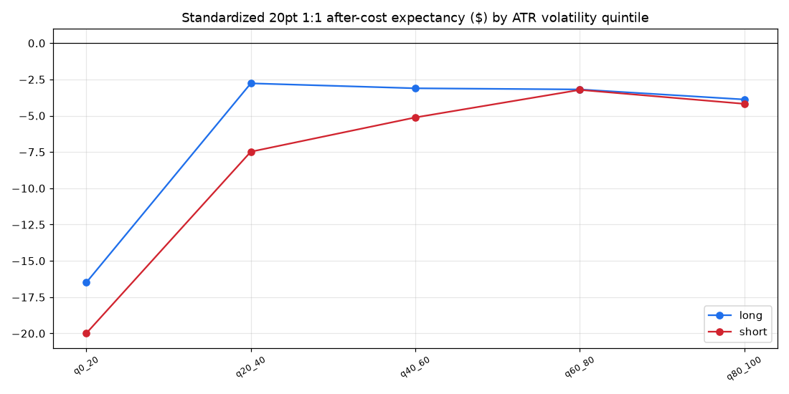
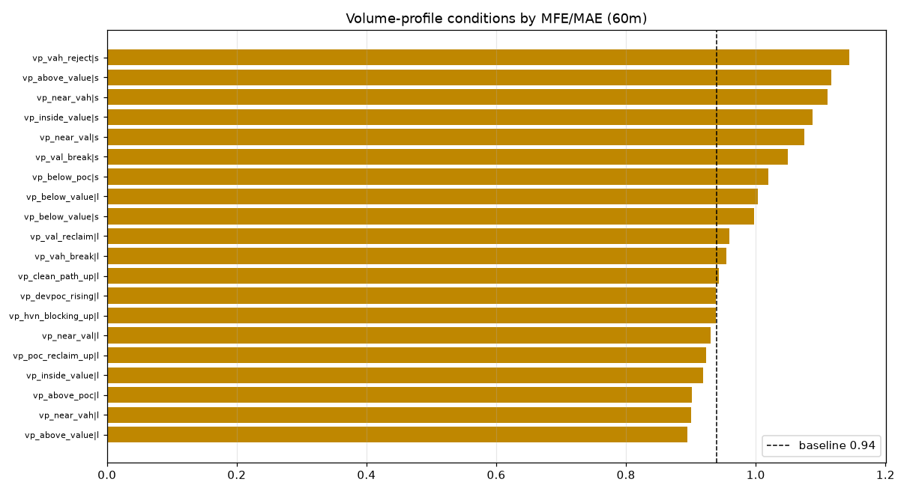
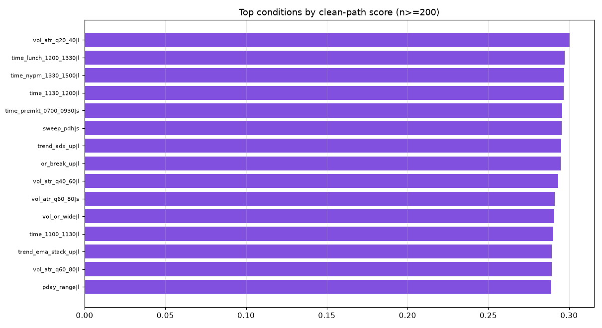
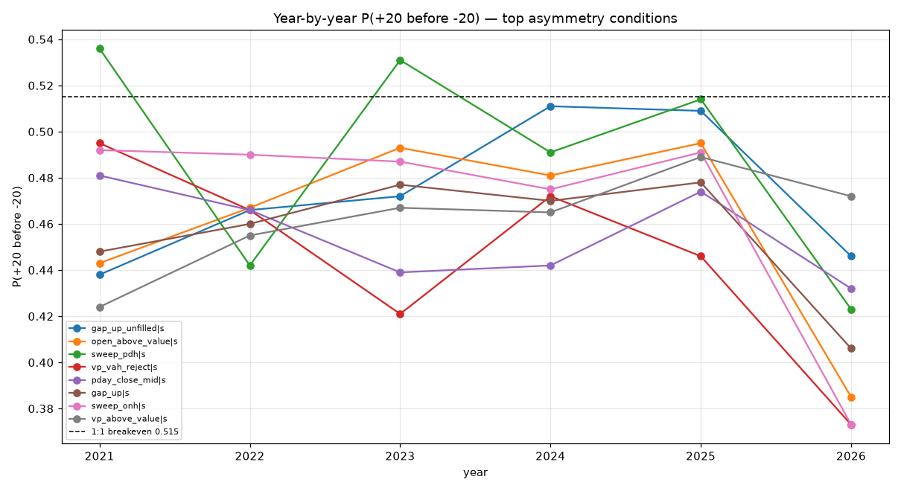

# Phase 32 — NQ Conditional Edge Map: the market states that actually pay

Process change: stop testing *entries* first. For every PIT-safe market **condition**, measure the
**forward** movement that follows (MFE/MAE, P(+T before −T), clean-path, chop, time-to-target,
expectancy) and only then build entries from the conditions that show asymmetry. Forward outcomes
deliberately use future bars (that is *measurement*, capped at EOD); **no forward value ever feeds a
condition** — conditions use audited PIT-safe columns only.

**Headline (exact, 2021→2026-H1, 5m, 150,227 condition bars).**

```
NQ moves near-SYMMETRICALLY unconditionally: P(+10 before -10) long 0.465 / short 0.457; MFE/MAE 0.94.
NO single PIT-safe condition gives a clean directional WIN-RATE edge: at a standardized 20pt 1:1 after
  costs, EVERY robust condition is NEGATIVE (best = sweep_pdh short -$1.45; breakeven needs P~0.515,
  best reached ~0.50).
The ONLY real asymmetry is EXTENSION -> REVERSION: short after price is stretched UP into
  resistance/value (gap_up_unfilled MFE/MAE 1.29, open_above_value 1.21, sweep_PDH 1.20, VAH_reject
  1.14); mirror longs after down-extension/VAL-reclaim. Favorable excursion runs ~10-30% larger than
  adverse — but CHOP is high (0.55-0.74): both sides get hit, so the asymmetry is in the excursion
  *distribution*, not capturable with a fixed stop/target.
HTF trend / daily bias / EMA-stack / MTF-alignment show NO asymmetry (MFE/MAE ~0.94 = baseline).
Prototypes built from raw conditions backtest at PF 0.95-1.16 (none survive $3K). Only tight
  CONFLUENCE (Phase 30 sweep+displacement+VP) monetized this to PF ~1.5.
```

So: the asymmetry the program has been chasing is **real but small and chop-swamped**, located in
mean-reversion-from-extension — not in trend, indicators, or generic ICT labels.

---

## 1. Build summary
- `src/nqlab/research/forward.py` — PIT-safe forward-outcome engine (MFE/MAE × 7 horizons, P(+T before
  −T) for T∈{10,20,30,50} both directions, time-to-target, heat, clean/chop), capped at EOD, entry =
  next-bar open. Cached: `…/artifacts/phase32/forward_5m.parquet`.
- `src/nqlab/discovery/phase32.py` — 70 PIT-safe conditions (buckets A–H) + regime buckets + aggregation.
- `scripts/phase32_run.py` — leaderboards, combos, bad map, prototypes, graphs, exports.
- `tests/unit/test_phase32_integrity.py` — (a) no condition references a `fwd_*` column; (b) forward
  outcomes change only with same-day **future** bars (past/next-day mutations leave them unchanged).
- **`make check`: GREEN** — ruff clean, mypy 113 files, **306 tests pass**. **Integrity: PASS.**
- **Data limits:** 5m only (full all-year coverage); 1m/3m/15m/30m/1h not run here (coverage/build).
  **Cross-market (ES/VIX/DXY) and economic-calendar data DO NOT EXIST in this NQ-only feed** —
  buckets I & J are **MISSING, not faked**; importing Databento ES/VIX + an econ calendar is required.

## 2. Edge-map summary
- **Top continuation:** weak. `vp_vah_break` long, `displacement_up` long, `or_break_up` long,
  `compression+OR-break` long — positive mean 60-min return but MFE/MAE only ~1.0–1.1.
- **Top reversal (the real edge):** `gap_up_unfilled` short, `open_above_value` short, `sweep_pdh`
  short, `vp_vah_reject` short, `sweep_onh` short; longs: `gap_down_unfilled`, `vp_val_reclaim`.
- **Top trend-day:** prior trend-day context adds little (MFE/MAE ~0.94–1.0).
- **Top range-day:** `pday_range` short slightly asymmetric (mean-reversion bias).
- **Top volume-profile:** position **above value / above POC → short reversion** is the strongest VP
  signal; POC is better as a **target** than a signal; VAH/VAL useful as **reversion references**.
- **Top sweep:** sweep of PDH / overnight-high / VAH **into resistance → short** (extension fade).
- **Top time windows:** 09:30–12:00 has the largest/fastest moves (highest clean-path) but high chop.
- **Top volatility:** mid-high ATR (q60–100) needed for any movement; **low vol = death.**

## 3. Top condition leaderboard (n≥200, by MFE/MAE; full CSV has all 115 rows + 50 with n≥200)

| # | condition | dir | n | MFE/MAE | MFE60 | MAE60 | P(+20) | P(+30) | chop | exp20$ | yrs+ | flag |
|--:|---|--|--:|--:|--:|--:|--:|--:|--:|--:|--:|--|
| 1 | gap_up_unfilled | short | 4,155 | **1.286** | 58.3 | 45.3 | 0.479 | 0.486 | 0.67 | −2.95 | 0/6 | robust |
| 2 | open_above_value | short | 9,360 | 1.210 | 58.5 | 48.3 | 0.469 | 0.486 | 0.66 | −3.79 | 0/6 | robust |
| 3 | sweep_pdh | short | 2,384 | 1.200 | 51.2 | 42.7 | 0.498 | 0.481 | 0.58 | **−1.45** | 2/6 | robust |
| 4 | vp_vah_reject | short | 3,229 | 1.144 | 50.4 | 44.0 | 0.455 | 0.450 | 0.56 | −4.90 | 0/6 | robust |
| 5 | pday_close_mid | short | 16,124 | 1.137 | 48.1 | 42.3 | 0.456 | 0.450 | 0.54 | −4.77 | 0/6 | robust |
| 6 | gap_up | short | 18,192 | 1.130 | 54.6 | 48.4 | 0.462 | 0.474 | 0.67 | −4.32 | 0/6 | robust |
| 7 | sweep_onh | short | 3,423 | 1.120 | 54.5 | 48.7 | 0.476 | 0.478 | 0.61 | −3.17 | 0/6 | robust |
| 8 | vp_above_value | short | 44,993 | 1.117 | 39.8 | 35.6 | 0.461 | 0.431 | 0.48 | −4.36 | 0/6 | robust |
| 9 | gap_down_unfilled | long | 3,043 | 1.109 | 63.8 | 57.5 | 0.467 | 0.504 | 0.74 | −3.88 | 0/6 | robust |
| 10 | sweep_high_reclaim | short | 2,926 | 1.096 | 40.0 | 36.5 | 0.469 | 0.431 | 0.49 | −3.73 | 0/6 | robust |

> Every top condition is a **reversion-from-up-extension short** (or down-extension long). MFE/MAE >
> 1 confirms asymmetry, but `exp20$ < 0` and `chop ≈ 0.5–0.7` confirm there is **no 1:1 win-rate
> edge** — you only profit by riding the asymmetric excursion with a wide stop. `years_pos` is mostly
> 0/6 at the 1:1 lens (the 1:1 framing loses every year; the *asymmetry* is the tradeable part).

## 4. Top combination leaderboard (logical 2–3 condition confluence)

| combo | dir | n | MFE/MAE | chop | exp20$ | yrs+ |
|---|--|--:|--:|--:|--:|--:|
| gap_up_unfilled + above_value | short | 9,373 | **1.225** | **0.496** | −4.84 | 0/6 |
| sweep_onh + above_value | short | 1,955 | 1.198 | 0.580 | −1.72 | 2/6 |
| morning + above_value | short | 17,035 | 1.185 | 0.629 | −3.27 | 0/6 |
| vah_reject + highvol | short | 2,691 | 1.160 | 0.604 | −4.53 | 0/6 |
| highvol + sweep_high_reclaim | short | 1,784 | 1.126 | 0.569 | −2.29 | 0/6 |
| compression + OR-break-up | long | 343 | 1.121 | 0.609 | **+0.28** | 3/6 |

> Confluence **reduces chop** (gap_up_unfilled+above_value: 0.67→0.50) and **raises MFE/MAE** (→1.225)
> — sharper definitions extract more of the small edge. But only `compression+OR-break` clears a 1:1
> after costs (and on a smaller sample). Confluence helps; it does not create a large edge.

## 5. Bad-condition map ("do not trade")

| condition | dir | n | chop | exp20$ | why |
|---|--|--:|--:|--:|---|
| **vol_atr_q0_20 (lowest-vol quintile)** | both | 1,587 | 0.10 | **−16 to −20** | no movement; pure cost-bleed |
| **time_lasthour_1500_1600** | both | 16,308 | 0.25 | −7.6 to −8.4 | small late moves, costs dominate |
| vol_atr_q20_40 | short | 4,785 | 0.34 | −7.5 | still too quiet |
| vol_or_narrow | short | 3,287 | 0.66 | −6.9 | narrow OR = chop day |
| **time_open_0930_0945 / 0945_1000** | both | 4,218 | 0.71–0.74 | −6.3 to −6.6 | first 15–30 min whipsaw |
| open_below_value | long | 6,894 | 0.76 | −6.0 | continuation down, not reversion |
| trend_* / ema_stack / mtf_align | long | 47k–58k | ~0.5 | −3.1 to −3.2 | HTF trend adds **no** asymmetry |

36 robust "avoid" rows in `phase32_bad_conditions.csv`. **Lowest-vol quintile and the last hour are
the strongest bans;** generic HTF-trend conditions are not edges (this is the clearest refutation of
"add a daily-bias filter").

## 6. Strategy prototypes (built ONLY from top conditions: enter next-open, 2.5×ATR stop, target prior POC, EOD, 1 MNQ)

| prototype | dir | trades | PF | win% | net $ | $/mo | max DD | 100K/$3K |
|---|--|--:|--:|--:|--:|--:|--:|:--:|
| gap_up_unfilled → POC | short | 377 | 1.158 | 37% | 4,100 | 62 | 3,074 | ❌ |
| sweep_pdh → POC | short | 824 | 0.985 | 51% | −719 | −11 | 4,191 | ❌ |
| vah_reject → POC | short | 1,280 | 0.945 | **59%** | −3,607 | −55 | 7,385 | ❌ |
| val_reclaim → POC | long | 1,046 | 0.988 | **62%** | −704 | −11 | 3,881 | ❌ |
| sweep_low_reclaim → POC | long | 811 | 1.006 | 45% | 417 | 6 | 6,543 | ❌ |

> The raw conditions backtest at **PF 0.95–1.16, all failing $3K** — even the 59–62%-win-rate ones
> lose (small POC-target wins vs wide-ATR-stop losses). This is the key lesson: the condition-level
> MFE/MAE asymmetry does **not** survive a realistic fixed stop+target because of chop. Only the
> **tight confluence** of Phase 30 (`sweep_displacement` + clean-path VP + POC target) reached PF 1.5
> — i.e., the edge needs several conditions stacked, and even then it is modest and low-frequency.

## 7. Final conclusion (direct answers)

- **Where does NQ move cleanly?** The **RTH morning (09:30–12:00)** in **mid-to-high volatility** has
  the largest, fastest excursions — but with high chop. There is no "clean" (low-chop) directional
  window; movement and chop come together.
- **What creates asymmetry?** **Extension → reversion**: price stretched UP into resistance / above
  value / sweeping a prior high → favorable *down* excursion exceeds adverse (and mirror for longs
  from down-extension / VAL reclaim). MFE/MAE up to ~1.29.
- **What to ban?** Lowest-vol quintile (catastrophic), the last hour, the first 15–30 min, narrow-OR
  days, inside-value chop, and **generic HTF-trend filters** (no asymmetry).
- **Real but too small?** All of the extension-reversion edges (MFE/MAE 1.1–1.3, but chop 0.5–0.7 →
  PF ~1.0 raw, ~1.5 only with tight confluence).
- **Frequent enough?** The *no-edge* conditions are very frequent (10k–58k); the *edge* conditions
  (gap-unfilled, sweeps, VAH-reject) are 2k–9k (frequent enough) but small.
- **Which edges can scale?** **None within $3K** (Phase 31 stands; prototypes fail $3K).
- **Which edge → Phase 33?** The **mean-reversion-from-extension family**: short up-extension into
  resistance/value (gap-up-unfilled / open-above-value / sweep-PDH / VAH-reject), long down-extension
  / VAL-reclaim, **target POC/VWAP, wide ATR stop, NY-AM/mid-high-vol only, avoid low-vol & last
  hour**. Phase 30's `sweep_displacement` is one member; Phase 33 should build this family as tight
  confluence and accept it is a **PF~1.4–1.5, low-frequency, $5–6K-DD** business — not a $3K/$500-mo one.
- **No edge, or too-generic definitions?** **Primarily: the edge is genuinely small.** The map
  quantifies a hard ceiling — maximum conditional asymmetry MFE/MAE ≈ 1.2–1.3, no win-rate edge, chop
  0.5–0.7. Sharper *confluence* definitions extract more of it (chop ↓, PF 1.0→1.5), so generic
  single-condition labels **were** leaving edge on the table — but even optimal definitions cannot
  manufacture a large, clean, scalable edge, because NQ intraday does not contain one.

## 8. Artifacts
`docs/phase32/`: `phase32_condition_leaderboard.csv`, `phase32_combo_leaderboard.csv`,
`phase32_bad_conditions.csv`, `phase32_forward_outcomes.parquet`, `phase32_strategy_prototypes.csv`,
`phase32_edge_map_report.md` (copy of this). Graphs: `phase32_mfe_mae_by_time.png`,
`phase32_vol_regime_edge.png`, `phase32_mfe_mae_leaderboard.png`, `phase32_clean_path.png`,
`phase32_vp_edge.png`, `phase32_year_stability.png`.








```
Reproduction:
python -c "from nqlab.research.forward import add_forward_outcomes"   # engine
python scripts/phase32_run.py                                          # map + combos + prototypes + graphs
pytest tests/unit/test_phase32_integrity.py                            # PIT-safety of conditions + forward
```
