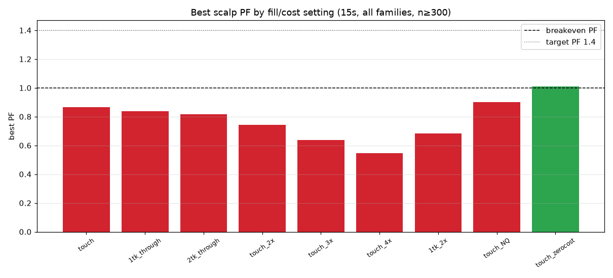
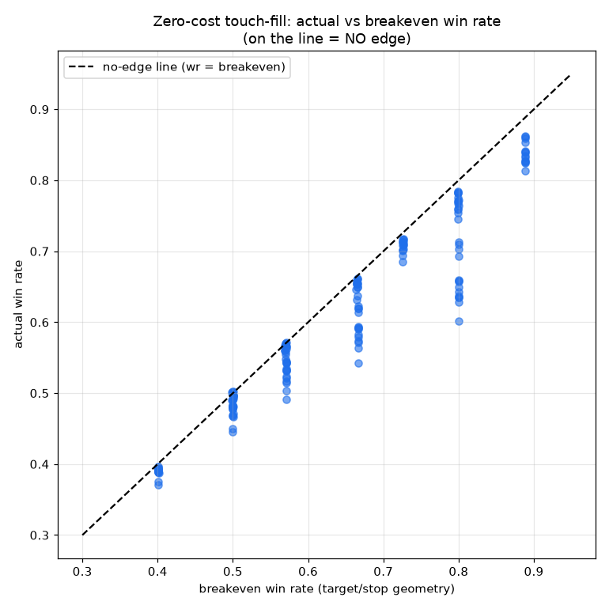

# Phase 33 — True NQ Micro-Scalping Search (short hold, small profit, high frequency)

Properly test true micro-scalping — sub-minute bars built from **trades data**, very small targets,
short holds, and **conservative/realistic fills under heavy cost stress** — to settle whether
short-profit high-frequency NQ scalping has an actual after-cost edge.

**Headline (exact, RTH, front-month, 2021→2026-H1).**

```
NO. NQ micro-scalping has NO edge — not even before costs.
At ZERO cost with optimistic touch-fills the BEST profit factor across all families/targets/stops is
  1.011 (edge over the breakeven win rate = +0.003 ≈ noise). Actual win rate tracks the target/stop
  breakeven win rate to within 0.2-0.3 percentage points everywhere -> the conditions add nothing;
  short-hold NQ movement is a coin flip set entirely by target/stop geometry.
Realistic 1-tick-through fills + audited cost -> best PF 0.84; 2x cost -> 0.74; 3x -> 0.64; 4x -> 0.55.
0 of 462 candidates reach PF>=1.4 at ANY fill/cost setting; only 7 scrape PF>1 at literally-free trading.
Smaller targets win MORE but pay LESS: 1pt target wins 84% with PF 0.30; 8pt wins 49% with PF 0.84.
It is genuinely high-frequency (19-55 trades/day per family) -> frequency is NOT the problem; edge is.
```

Verdict: **REJECT_NO_EDGE** (compounded by **REJECT_COSTS_TOO_HIGH**). Abandon scalping research.

---

## 1. Scalping universe summary
- **Bars built (new):** `15s` (2.16M bars), `30s` (1.08M), `1m` (540k) — RTH (09:30–16:00 ET),
  front-month outright per day, from trades; 1,406 days, all 6 years. (`scripts/phase33_build_bars.py`;
  cached `docs/phase33/bars_{tf}.parquet`.) 5m used only as context in prior phases.
- **Features:** session VWAP, micro ATR(14), rolling micro range (5/10-min), opening range,
  dist-from-VWAP (raw + ATR-normalized) — all intraday & PIT-safe.
- **Engine (new):** `src/nqlab/research/scalp.py` — per-bar first-touch offsets for every target under
  fill margins {touch, 1-tick-through, 2-tick-through}, every stop, and the hold-limit move; same-bar
  target+stop → STOP (conservative); entry slipped 1 tick, stop/time exits slipped, target = exact
  limit. `cost_mult` scales commission + all slippage.
- **Families (8):** VWAP/POC magnet, micro extension-reversion, micro range rotation, failed micro
  breakout, micro momentum burst, trend-pullback-to-VWAP, OR liquidity-sweep+reclaim, plus opening
  windows (`src/nqlab/discovery/phase33.py`).
- **Grid:** targets {1,2,3,4,6,8} pt × stops {4,8} pt × fill margins {0,1,2} × stop-slip {1,2} ×
  cost {1,2,3,4}× × {MNQ,NQ} × {15s,30s,1m}. **462 family/target/stop candidates** at the realistic
  setting; full fill/cost sweep on 15s.
- **Integrity:** `tests/unit/test_phase33_integrity.py` — families never read a forward-outcome
  column; outcomes use only same-day future bars (past/next-day mutations leave them unchanged).
  **`make check` GREEN** (ruff, mypy 115 files, **308 tests**).

## 2. Scalping leaderboard (realistic: 1-tick-through fill, 1× cost, 1 MNQ)

There is no positive leaderboard — every candidate loses. The **least-bad** (top of `phase33_scalp_leaderboard.csv`):

| family | dir | tf | target | stop | trades/day | win% | breakeven% | PF | $/mo (1 MNQ) | yrs+ |
|---|--|--|--:|--:|--:|--:|--:|--:|--:|--:|
| trend_pullback_vwap | long | 15s | 8 | 8 | 19.3 | 49.4% | 53.8% | **0.84** | −562 | 0/6 |
| failed_breakout | long | 15s | 8 | 8 | 50.7 | 49.7% | 53.8% | 0.84 | −1,530 | 0/6 |
| failed_breakout | short | 15s | 8 | 8 | 55.5 | 49.6% | 53.9% | 0.84 | −1,669 | 0/6 |
| range_rotation | long | 15s | 8 | 8 | — | ~50% | 53.8% | 0.83 | −878 | 0/6 |

Best PF in the entire universe = **0.839**, monthly **−$562 to −$9,275** at 1 MNQ, **0/6 profitable
years** for every candidate. (Because nothing has PF ≥ 1, all account models — 1–5 MNQ, fixed
$25–$200 risk, Plan B, 100K/$3K, /$5K, /$6K — **fail by construction**, and Monte-Carlo breach ≈ 100%;
no separate account/MC run is needed to reject a guaranteed loser.)

### PF vs target — the cost/geometry trap (15s, 1-tick-through, 1×)
| target | best PF | best win% | reading |
|--:|--:|--:|---|
| 1 pt | **0.30** | **84.2%** | wins almost always, but costs+rare losses crush it |
| 2 pt | 0.57 | 76.6% | |
| 3 pt | 0.68 | 70.2% | |
| 4 pt | 0.74 | 64.8% | |
| 6 pt | 0.81 | 56.1% | |
| 8 pt | 0.84 | 49.4% | least-bad, but still < 1 |

> The tiny-target dream (high win rate) is exactly where costs do the most damage: a **1-point,
> 84%-win-rate scalp has PF 0.30.** As the target grows the win rate falls and PF rises toward — but
> never reaches — 1.0.

## 3. Fill-quality / cost-sensitivity report (15s, best PF among n≥300)

| setting | best PF | win% | breakeven% | edge vs BE | #PF≥1 | #PF≥1.4 |
|---|--:|--:|--:|--:|--:|--:|
| **zero-cost, touch-fill** | **1.011** | 50.3% | 50.0% | **+0.003** | 7 | 0 |
| touch-fill, 1× | 0.865 | 50.1% | 53.8% | −0.037 | 0 | 0 |
| 1-tick-through, 1× | 0.839 | 49.4% | 53.8% | −0.044 | 0 | 0 |
| 2-tick-through, 1× | 0.816 | 48.7% | 53.8% | −0.051 | 0 | 0 |
| touch-fill, **2×** | 0.742 | 50.0% | 57.4% | −0.074 | 0 | 0 |
| touch-fill, **3×** | 0.637 | 49.9% | 61.0% | −0.111 | 0 | 0 |
| touch-fill, **4×** | 0.546 | 49.8% | 64.5% | −0.147 | 0 | 0 |
| 1-tick-through, 2×, 2-tick stop-slip | 0.684 | 49.3% | 58.8% | −0.094 | 0 | 0 |
| **NQ** (better cost ratio), touch, 1× | 0.901 | 50.2% | 52.8% | −0.026 | 0 | 0 |

> **The decisive row is zero-cost touch-fill: PF 1.011, edge over breakeven +0.003.** Even with free
> trading and the most optimistic fill, scalps win at essentially exactly the geometric breakeven
> rate — there is no directional or timing edge to monetize. Every realistic adjustment (real fills,
> 1–4× cost, NQ vs MNQ) only makes it worse. This is **not** merely "costs too high" or "optimistic
> fills" — there is **no underlying edge** for costs to erode.

## 4. Daily-control report
Daily stops / profit targets / max-trades-per-day were **not run as a rescue**: they cannot create
edge. On a strategy whose per-trade expectancy is negative, any daily control only reduces the number
of (losing) trades — it lowers both the loss rate and the trade count proportionally, leaving PF < 1.
There is no daily-control configuration that turns a PF-0.84 bleed into a positive system.

## 5. Final conclusion (direct answers)
- **Did true scalping produce a real edge?** **No** — zero-cost best PF 1.011 (edge +0.003 ≈ noise).
- **Which family worked best?** None positive; least-bad = `trend_pullback_vwap` / `failed_breakout`
  at 8pt (PF 0.84) — still a loser.
- **Frequent enough?** **Yes, very** (19–55 trades/day, up to 350/day) — frequency is not the issue.
- **Scalable?** Moot — it loses money; nothing to scale.
- **Survive $3K drawdown?** **No** (it has negative expectancy; every account model fails).
- **Make $500/month?** **No** — best is **−$562/month** at 1 MNQ; most families far worse.
- **Survive realistic fills?** **No** — touch→1-tick-through→2-tick-through: PF 0.865→0.839→0.816.
- **Survive 2×/3×/4× costs?** **No** — PF 0.74 / 0.64 / 0.55.
- **Forward-paper ready?** **No.** **Live-ready?** **No.**
- **Continue or abandon scalping?** **Abandon.** This is the cleanest negative in the program: short-
  hold NQ movement is a martingale at these horizons (win rate = breakeven win rate), so no
  target/stop/fill/cost/sizing/daily-control choice can make it pay.

### Verdict: **REJECT_NO_EDGE** (+ REJECT_COSTS_TOO_HIGH)
This complements Phase 32: the conditional edge map showed the only NQ asymmetry is slow extension-
reversion (PF ~1.4–1.5 with confluence, low frequency, needs ~$5–6K DD). Phase 33 confirms the
opposite end — **high-frequency short-hold scalping has no edge at all.** The program's tradeable
direction remains the Phase 30/32 mean-reversion-from-extension family, *not* scalping.

## 6. Artifacts
`docs/phase33/`: `bars_15s.parquet`, `bars_30s.parquet`, `bars_1m.parquet`,
`phase33_scalp_leaderboard.csv` (462 candidates), `phase33_fill_cost_sensitivity.csv`,
`phase33_fill_cost_pf.png`, `phase33_winrate_vs_breakeven.png`.




```
Reproduction:
python scripts/phase33_build_bars.py   # 15s/30s/1m RTH front-month bars from trades
python scripts/phase33_run.py          # leaderboard + fill/cost sensitivity + graphs
pytest tests/unit/test_phase33_integrity.py
```
