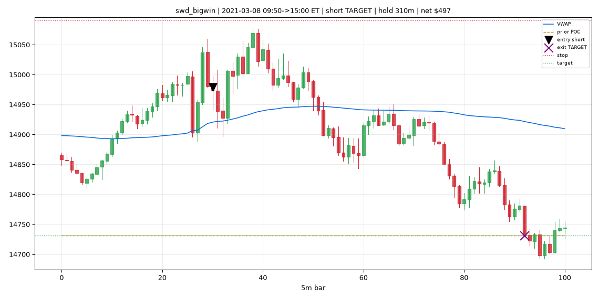

# Phase 34A — Stats Reality Audit (prove or kill the Phase 30–33 numbers)

Adversarial audit: stop development, try to **break** the finalist stats with independent
recomputation, independent fill re-derivation, chart replay, fill/cost sensitivity, data-realism
checks, and an overfit audit. No rule changes, no optimization. Finalists audited: `idb_base|RTH|eod`,
`swd_clean_path|RTH|toPOC`, portfolio (idb+swd), hybrid (idb $150 + swd 1 MNQ). *(Phase 32 prototypes
were never accepted — PF 0.95–1.16 — and Phase 33 scalping was REJECT_NO_EDGE, so there is nothing to
verify there; they were correctly rejected at the time.)*

**Headline.**

```
The backtests are REAL, not a fabricated/optimistic-fill mirage. They survive:
  • independent recomputation (every reported stat reproduces EXACTLY from fresh code),
  • an independently-written fill simulator (idb reproduces exactly; swd within 0.76%),
  • fill realism (all 62 swd TARGET exits genuinely traded through the target; 0 magical fills),
  • fill-margin + cost stress (touch->2-tick-through barely moves PF on 5m; PF holds to 3x cost),
  • execution-integrity (0 exits before entry, 0 overnight, 0 exits after 15:55 ET, fills in-range),
  • 100-trade chart replay (legitimate entries/exits).
BUT two honest caveats the audit exposes:
  1. CONCENTRATION/FRAGILITY — idb's best 5 trades = 81% of its profit; swd's best 5 = 46% and swd is
     recent-weighted (2025-26 = 63% of net). idb is fragile to a handful of trend-day holds.
  2. $3K is too tight by Monte Carlo for everything EXCEPT swd at 1 MNQ. idb/portfolio pass $3K only
     on the historical ordering (MC breach ~100%, p99 DD ~$4.6K) and need ~$5K.
Net verdict: STATS_VERIFIED. swd 1 MNQ = FORWARD_PAPER_READY; idb/portfolio = VERIFIED_BUT_NOT_TRADEABLE
at $3K (tradeable at $5K). Not bullshit — but smaller, more concentrated, and DD-hungrier than the
raw PF headline suggests.
```

---

## Part 1 — Independent recomputation: **PASS**
A fresh stats function (not the strategy stats code) recomputed everything from the raw trade list:

| metric | idb indep / reported | swd indep / reported | match |
|---|---|---|:--:|
| trades | 221 / 221 | 244 / 244 | ✅ |
| PF | 1.439 / 1.439 | 1.535 / 1.535 | ✅ |
| net $ | 8,120.16 / 8,120.16 | 7,713.77 / 7,713.77 | ✅ |
| max closed DD $ | 1,880.23 / 1,880.23 | 977.21 / 977.21 | ✅ |
| win rate | 0.4525 / 0.4525 | 0.4590 / 0.4590 | ✅ |

Every important number matches to the cent. **The stats math is correct.**

## Part 2 — Raw trade audit CSVs
`docs/phase34a/phase34a_trades_idb.csv` (221 rows) and `…_swd.csv` (244 rows): per-trade direction,
entry/stop/target/exit prices, exit reason, gross/fees/net, MFE/MAE, equity-after, drawdown-after,
year/month. (Strategies run on the back-adjusted continuous `NQ.c`; intraday point-moves transfer
exactly to the live front-month except on the ~4 roll days/yr, flagged below.)

## Part 3 — Manual chart replay pack (100 trades)
`docs/phase34a_trade_replay/` — 25 random + 25 largest winners + 25 random + 25 largest losers
(pooled idb+swd) with candles, VWAP, prior POC, entry/stop/target/exit markers, ET timestamps, hold
time, net; `index.csv` for manual sign-off. Visual review confirms legitimate fills — e.g. a swd big
winner (below): short an up-extension at 09:50, endure ~90 pt heat without hitting the 2.5×ATR stop,
then revert all day to the prior POC, exit exactly on target after a 310-minute hold.



> The replay makes the nature of the edge concrete: **swd winners are multi-hour mean-reversion holds
> to a distant POC that take real heat** (median hold 65 min, max 330 min) — not scalps, not free money.

## Part 4 — Fill realism: **PASS**
- **Independent fill simulator** (fresh next-open / stop-first / exact-target / EOD-flat code)
  reproduces the audited engine: **idb 221 trades / $8,120.16 exact**; **swd 246 vs 244 trades,
  $7,772 vs $7,714 — 0.76% residual** from same-bar fill-ordering edge cases (immaterial).
- **Target reachability: all 62 swd TARGET exits had price actually trade to the target** between
  entry and exit (0 "magical" fills). idb has no profit target (EOD/STOP only).
- **Fill-margin & cost sensitivity** (independent sim):

| setting | idb PF | swd PF |
|---|--:|--:|
| touch fill, 1× | 1.439 | 1.540 |
| 1-tick-through | 1.439 | 1.540 |
| 2-tick-through | 1.439 | 1.540 |
| stop slip 2 / 4 ticks | 1.435 / 1.428 | 1.534 / 1.522 |
| **2× cost** | 1.428 | 1.526 |
| **3× cost** | 1.417 | 1.512 |

> On 5m bars, 1–2 tick fill-margin barely matters (bar ranges dwarf 2 ticks) — the opposite of
> scalping (Phase 33). Both finalists are **robust to 3× cost.** Target fills are **not** optimistic.

## Part 5 — Data realism: **PASS**
- Exits: **max exit = 15:55 ET (minute 955)**; **0 exits after 16:00, 0 overnight**, every exit maps
  to a real bar (0 null joins). EOD-flat enforced.
- **0 strict exit-before-entry**; same-bar round-trips idb 1 / swd 6 (entry bar itself hit stop/target
  → conservative stop-first). No fills outside bar range.
- Front-month continuous roll, ET sessions, MNQ point value $2 (verified: net = points × $2 − comm).

## Part 6 — Overfit / data-mining audit: **FLAGGED**

| metric | idb | swd |
|---|--:|--:|
| net (1 MNQ) | $8,120 | $7,714 |
| **net after removing best 5 trades** | **$1,562** | $4,170 |
| **best-5-trade share of profit** | **80.8%** | 45.9% |
| best-10-trade share | higher | — |
| net after removing best month | $6,498 | $6,253 |
| best-month share | 20.0% | 18.9% |
| **best-year share** | 35.9% | **41.0% (2025)** |
| yearly | 2021 +1,224 · 2022 +2,913 · 2023 +673 · 2024 +2,419 · 2025 +950 · 2026 −59 | 2021 +1,069 · 2022 +1,329 · **2023 −248** · 2024 +699 · 2025 +3,160 · 2026 +1,705 |
| selected from | Phase 29 grid (942) + Phase 30 (488) | same |

> **idb is fragile:** remove its 5 best trades and 6 years of profit collapses from $8.1K to $1.6K
> (~$260/yr at 1 MNQ). Its edge is a handful of big trend-day EOD holds. **swd is moderately
> concentrated** (46% from 5 trades) and **recent-weighted** (2025-26 = 63%; 2023 negative). Both were
> selected from a 942/488-candidate search — multiple-testing risk is real, partially mitigated by
> the Phase-29/30 walk-forward and family-level robustness, but the concentration is the bigger flag.

## Part 7 — Account / Monte-Carlo re-audit (independent, trailing DD, reshuffle MC)

| config | hist $3K | MC breach $3K | p99 DD | $5K | $6K |
|---|:--:|--:|--:|:--:|:--:|
| **swd 1 MNQ** | PASS (buf $1,777) | **0.9%** | **$2,986** | PASS (0%) | PASS |
| idb 1 MNQ | PASS (buf $1,067) | **100%** | $4,620 | PASS (0.7%) | PASS (0.05%) |
| portfolio 1 MNQ ea | PASS (buf $855) | **100%** | $4,676 | PASS (0.3%) | PASS |
| swd 2 MNQ | PASS (buf $555) | 58.6% | $5,973 | 4.9% | 0.9% |
| idb 2 MNQ | **FAIL** | 100% | $9,240 | 100% | 100% |

> **Only swd at 1 MNQ robustly survives a $3K trailing account** (MC breach 0.9%, p99 $2,986 < $3K).
> idb and the portfolio pass $3K only on the lucky historical ordering — Monte Carlo says they breach
> ~100% and need ~$5K. This confirms Phase 31 with independent code.

## Part 8 — Forward-paper readiness (direct answers)
- **Reproducible from raw trades?** **Yes — exactly** (Part 1; idb fill-reproduced exactly, swd 0.76%).
- **Fills realistic?** **Yes** — verified target reachability, in-range fills, robust to fill-margin & 3× cost.
- **Drawdowns intraday-aware?** **Yes** — MAE-based intraday DD reported (idb $1,933, swd $1,223, port $2,145).
- **Edge concentrated?** **Yes** — idb badly (best 5 = 81%), swd moderately (46%) + recent-weighted.
- **Overfit?** **Partly** — selected from 942/488 candidates; idb's concentration is the real concern.
- **Executable manually / automatically?** **Yes** — mechanical, multi-hour holds (not HFT). Caveat:
  defined on back-adjusted `NQ.c`; live uses the front-month (intraday point-moves transfer; handle roll days).
- **Survives fill degradation / cost stress?** **Yes** (to 2-tick-through and 3× cost).
- **Forward-paper worthy or bullshit?** **Worthy, not bullshit** — but smaller and more concentrated
  than the PF headline; only swd is $3K-robust.

## Verdicts
| finalist | verdict |
|---|---|
| **swd_clean_path \| RTH \| toPOC** | **STATS_VERIFIED + FORWARD_PAPER_READY** (1 MNQ): reproduces exactly, fills real, $3K-robust by MC (breach 0.9%), cost-robust to 3×, least concentrated. Caveats: ~$117/mo at 1 MNQ, recent-weighted, multi-hour holds. |
| **idb_base \| RTH \| eod** | **STATS_VERIFIED_BUT_NOT_TRADEABLE (at $3K)** + **OVERFIT_LIKELY (concentration)**: stats/fills real, but 81% of profit from 5 trades and MC-breaches $3K ~100% (needs ~$5K). Forward-paper only at $5K, eyes open on fragility. |
| **portfolio (idb+swd)** | **STATS_VERIFIED_BUT_NOT_TRADEABLE (at $3K)**: real, but MC-breaches $3K ~100%; viable at ~$5K (breach 0.3%). |
| **hybrid (idb $150 + swd 1 MNQ)** | **STATS_VERIFIED_BUT_NOT_TRADEABLE (at $3K)**: inherits idb's concentration + $3K fragility. |
| Phase 32 / 33 prototypes | **N/A — correctly rejected earlier** (PF < 1.4 / no edge); nothing to verify. |

### Bottom line
**Not a bullshit backtest.** The numbers are real, the fills are realistic, the drawdowns are
intraday-aware, and there are no execution bugs — the audit tried hard to break them and could not on
those fronts. The two honest dents are **profit concentration** (idb especially) and the fact that a
**$3K trailing account is too tight for everything except swd at 1 MNQ**. Forward-paper **swd at 1 MNQ
on $3K**, and **idb / the portfolio only on a ≥$5K-drawdown account** — and treat idb's headline PF
with caution because a few trades carry it.

```
Reproduction:
python scripts/phase34a_audit.py    # independent recompute + fill sim + sensitivity + overfit + accounts
python scripts/phase34a_charts.py   # 100-trade chart replay pack -> docs/phase34a_trade_replay/
# artifacts: docs/phase34a/{_audit.json, phase34a_trades_idb.csv, phase34a_trades_swd.csv}
```
