# Phase 30 Finalist Deep-Dive — Exact Frozen Stats, 100K/$3K Feasibility, Monte Carlo, Graphs

> **Frozen, not re-optimized.** These are the exact Phase-30 finalists re-run unchanged; the trade counts reproduce the frozen results (idb 221, swd 244, portfolio 465). All $ figures are **net of the audited cost model** (MNQ $1.00/$1.50 win/loss, slippage in fills). Sizing baseline = **1 MNQ**; other sizings scale per-contract (NQ derived exactly from the point move).

## Part 1 — Exact mechanical rules
### idb_base | RTH | a2.5 | eod
- **family:** inside_day_break (price-action breakout) | **timeframe:** 5m | **session:** RTH (entries 09:30-15:50 ET) | **direction:** both
- **entry rule:** Prior day was an INSIDE day (prev_inside_day==1). After the opening range forms (minute>=10:00 ET; OR=09:30-10:00 high/low), LONG when a 5m CLOSE breaks above or_high (and prior close<=or_high); SHORT when close<or_low. Fill next bar open.
- **signal rule:** long: prev_inside_day==1 & minute>=600 & close>or_high & close.shift(1)<=or_high; short: mirror with or_low.
- **confirmation:** none beyond inside-day filter + close-through-OR
- **stop rule:** 2.5 x ATR at the signal bar (ATR = base Wilder ATR). STOP slipped 1 tick.  → **stop type:** ATR (2.5x)
- **target rule:** NONE — hold to end of day (no fixed target).
- **exit rule:** EOD_FLAT at 15:55 ET, or the 2.5xATR stop, whichever first. No trailing / time stop.
- **RR:** DYNAMIC (no fixed target; realized R measured)
- **realized R:** avg **0.229** | median **-0.251** | avg win **1.562R** | avg loss **-0.881R** | best **13.144R** | worst **-1.066R**

### swd_clean_path | RTH | a2.5 | toPOC
- **family:** sweep_displacement (ICT) + volume-profile clean-path filter | **timeframe:** 5m | **session:** RTH (entries 09:30-15:50 ET) | **direction:** both
- **entry rule:** LONG: swept a confirmed swing LOW (swept_low==1) AND a displacement candle up (displacement==1 & close>open); FILTER: entry is below prior POC by >0.5 ATR (vp_d_poc_atr<-0.5) AND no opposing prior HVN within 1 ATR above the path (vp_dist_hvn_up_atr is null OR >1.0). SHORT: mirror. Fill next bar open.
- **signal rule:** long: swept_low==1 & displacement==1 & close>open & vp_d_poc_atr<-0.5 & (vp_dist_hvn_up_atr null or >1.0); short: mirror.
- **confirmation:** displacement candle in trade direction + clean path to POC (no blocking HVN)
- **stop rule:** 2.5 x ATR at the signal bar. STOP slipped 1 tick.  → **stop type:** ATR (2.5x)
- **target rule:** Prior-session POC (vp_prior_poc), distance clamped to [0.5, 8] x ATR; if POC is not in the trade direction, fallback target = 2 x stop. TARGET = exact limit.
- **exit rule:** POC target limit, or 2.5xATR stop, or EOD_FLAT 15:55, whichever first.
- **RR:** DYNAMIC (target = POC distance; realized R measured)
- **realized R:** avg **0.131** | median **-0.35** | avg win **1.356R** | avg loss **-0.908R** | best **3.198R** | worst **-1.029R**

### portfolio = idb_base + swd_clean_path (1 MNQ each)
- **family:** diversified pair (breakout + sweep/VP) | **timeframe:** 5m | **session:** RTH | **direction:** both
- **entry rule:** Run both strategies concurrently, 1 MNQ each, independently.
- **signal rule:** union of idb and swd signals
- **confirmation:** see idb + swd
- **stop rule:** each leg 2.5xATR  → **stop type:** ATR (2.5x)
- **target rule:** idb=EOD, swd=POC
- **exit rule:** each leg per its own rule; both flat by 15:55
- **RR:** DYNAMIC
- **realized R:** avg **0.177** | median **-0.269** | avg win **1.453R** | avg loss **-0.895R** | best **13.144R** | worst **-1.066R**

## Part 2 — Full stats (1 MNQ)
| metric | idb | swd | portfolio |
|---|--:|--:|--:|
| total trades | 221 | 244 | 465 |
| win rate | 0.4525 | 0.459 | 0.4559 |
| loss rate | 0.543 | 0.541 | 0.5419 |
| breakeven trades | 1 | 0 | 1 |
| PF before costs | 1.446 | 1.546 | 1.49 |
| PF after costs | 1.439 | 1.535 | 1.481 |
| net profit $ | 8120.16 | 7713.77 | 15833.93 |
| gross profit $ | 26614.5 | 22119.21 | 48733.71 |
| gross loss $ | -18494.34 | -14405.45 | -32899.79 |
| expectancy $/trade | 36.74 | 31.61 | 34.05 |
| expectancy $/month | 128.89 | 118.67 | 239.91 |
| avg win $ | 266.14 | 197.49 | 229.88 |
| avg loss $ | -154.12 | -109.13 | -130.55 |
| avg win/avg loss | 1.727 | 1.81 | 1.761 |
| max win $ | 2581.0 | 859.5 | 2581.0 |
| max loss $ | -622.61 | -394.84 | -622.61 |
| max consec wins | 6 | 5 | 6 |
| max consec losses | 9 | 8 | 12 |
| # 3-loss streaks | 13 | 17 | 30 |
| # 5-loss streaks | 4 | 6 | 7 |
| avg MFE (pts) | 109.52 | 77.37 | 92.65 |
| avg MAE (pts) | 65.55 | 50.24 | 57.51 |
| MFE/MAE | 1.671 | 1.54 | 1.611 |
| max closed-trade DD $ | 1880.23 | 977.21 | 2059.21 |
| avg DD $ | 522.52 | 291.14 | 454.18 |
| max DD date range | 2025-04-09..2026-04-30 | 2023-01-03..2023-10-26 | 2024-07-15..2024-11-07 |
| recovery (trades) after worst DD | None | 31 | 14 |
| return / maxDD | 4.319 | 7.894 | 7.689 |
| Sharpe | 2.554 | 2.667 | 2.627 |
| Sortino | 3.506 | 4.07 | 4.03 |
| Calmar | 7.304 | 8.841 | 5.682 |
| trades/week | 7.42 | 5.42 | 6.82 |
| trades/month | 3.51 | 3.75 | 7.05 |
| max trades in a day | 5 | 2 | 6 |
| avg hold (min) | 189.1 | 102.4 | 143.6 |
| median hold (min) | 195.0 | 65.0 | 100.0 |
| max hold (min) | 350.0 | 380.0 | 380.0 |
| min hold (min) | 0.0 | 0.0 | 0.0 |
| winning months | 38 | 37 | 41 |
| losing months | 25 | 28 | 25 |
| winning month % | 0.603 | 0.569 | 0.621 |
| profitable years | 5 | 5 | 6 |
| losing years | 1 | 1 | 0 |
| best month | 2025-04:1622 | 2025-11:1460 | 2021-02:1535 |
| worst month | 2024-10:-775 | 2022-04:-391 | 2025-01:-932 |
| best year | 2022:2913 | 2025:3160 | 2022:4242 |
| worst year | 2026:-59 | 2023:-248 | 2023:425 |

*Intraday (MFE/MAE-aware) max DD: idb $1,933 · swd $1,223 · portfolio $2,145 (see Part 5).*

## Part 3 — Year-by-year
### idb_base | RTH | eod
| year | trades | net $ | PF | win% | expectancy | max DD $ | ret/DD | maxLstreak | best mo | worst mo |
|--:|--:|--:|--:|--:|--:|--:|--:|--:|--|--|
| 2021 | 34 | 1224 | 1.67 | 47% | 36.0 | 350 | 3.5 | 5 | 2021-02:797 | 2021-07:-197 |
| 2022 | 36 | 2913 | 1.984 | 53% | 80.9 | 743 | 3.92 | 4 | 2022-10:884 | 2022-01:-589 |
| 2023 | 36 | 673 | 1.346 | 50% | 18.7 | 508 | 1.32 | 4 | 2023-03:276 | 2023-07:-244 |
| 2024 | 46 | 2419 | 1.716 | 37% | 52.6 | 1480 | 1.63 | 9 | 2024-04:1419 | 2024-10:-775 |
| 2025 | 49 | 950 | 1.178 | 43% | 19.4 | 1562 | 0.61 | 8 | 2025-04:1622 | 2025-01:-716 |
| 2026 | 20 | -59 | 0.981 | 45% | -2.9 | 1061 | -0.06 | 3 | 2026-06:694 | 2026-04:-473 |

### swd_clean_path | RTH | toPOC
| year | trades | net $ | PF | win% | expectancy | max DD $ | ret/DD | maxLstreak | best mo | worst mo |
|--:|--:|--:|--:|--:|--:|--:|--:|--:|--|--|
| 2021 | 50 | 1069 | 1.503 | 42% | 21.4 | 460 | 2.32 | 7 | 2021-02:738 | 2021-12:-239 |
| 2022 | 48 | 1329 | 1.392 | 40% | 27.7 | 636 | 2.09 | 4 | 2022-09:653 | 2022-04:-391 |
| 2023 | 33 | -248 | 0.858 | 46% | -7.5 | 977 | -0.25 | 6 | 2023-04:322 | 2023-03:-383 |
| 2024 | 56 | 699 | 1.204 | 46% | 12.5 | 826 | 0.85 | 5 | 2024-10:360 | 2024-04:-339 |
| 2025 | 46 | 3160 | 2.034 | 52% | 68.7 | 513 | 6.17 | 3 | 2025-11:1460 | 2025-12:-336 |
| 2026 | 11 | 1705 | 3.576 | 64% | 155.0 | 331 | 5.15 | 2 | 2026-03:1242 | 2026-02:-331 |

### portfolio (idb + swd, 1 MNQ each)
| year | trades | net $ | PF | win% | expectancy | max DD $ | ret/DD | maxLstreak | best mo | worst mo |
|--:|--:|--:|--:|--:|--:|--:|--:|--:|--|--|
| 2021 | 84 | 2293 | 1.58 | 44% | 27.3 | 558 | 4.11 | 8 | 2021-02:1535 | 2021-05:-261 |
| 2022 | 84 | 4242 | 1.668 | 45% | 50.5 | 1343 | 3.16 | 6 | 2022-10:868 | 2022-01:-501 |
| 2023 | 69 | 425 | 1.115 | 48% | 6.2 | 878 | 0.48 | 7 | 2023-04:560 | 2023-09:-411 |
| 2024 | 102 | 3119 | 1.458 | 42% | 30.6 | 2059 | 1.51 | 8 | 2024-12:1492 | 2024-10:-415 |
| 2025 | 95 | 4109 | 1.491 | 47% | 43.3 | 1536 | 2.67 | 8 | 2025-11:1491 | 2025-01:-932 |
| 2026 | 31 | 1647 | 1.442 | 52% | 53.1 | 1061 | 1.55 | 4 | 2026-03:1372 | 2026-02:-646 |

## Part 4 — Month-by-month net $ (1 MNQ)
Full per-finalist monthly detail (pnl / trades / win% / PF / maxDD) is in `phase30_monthly_detail.csv`. Combined monthly net below.
| month | idb $ | swd $ | port $ | | month | idb $ | swd $ | port $ |
|--|--:|--:|--:|--|--|--:|--:|--:|
| 2021-01 | -129 | 51 | -78 | | 2023-10 | 254 | -239 | 15 |
| 2021-02 | 797 | 738 | 1535 | | 2023-11 | 82 | 244 | 326 |
| 2021-03 | 24 | 148 | 172 | | 2023-12 | 87 | 223 | 310 |
| 2021-04 | 42 | 139 | 181 | | 2024-01 | -151 | 249 | 98 |
| 2021-05 | -94 | -167 | -261 | | 2024-02 | -324 | 159 | -165 |
| 2021-06 | -16 | 128 | 113 | | 2024-03 | 168 | -149 | 19 |
| 2021-07 | -197 | 301 | 103 | | 2024-04 | 1419 | -339 | 1080 |
| 2021-08 | 0 | -80 | -80 | | 2024-05 | 18 | 256 | 274 |
| 2021-09 | 243 | 5 | 248 | | 2024-06 | 951 | 101 | 1051 |
| 2021-10 | -72 | -152 | -225 | | 2024-07 | -131 | -109 | -240 |
| 2021-11 | 204 | 197 | 401 | | 2024-08 | 126 | -195 | -69 |
| 2021-12 | 421 | -239 | 182 | | 2024-09 | -295 | -9 | -304 |
| 2022-01 | -589 | 88 | -501 | | 2024-10 | -775 | 360 | -415 |
| 2022-02 | 114 | 266 | 380 | | 2024-11 | 24 | 273 | 297 |
| 2022-03 | 876 | -169 | 707 | | 2024-12 | 1389 | 103 | 1492 |
| 2022-04 | 415 | -391 | 24 | | 2025-01 | -716 | -217 | -932 |
| 2022-05 | -553 | 601 | 47 | | 2025-02 | 129 | -81 | 48 |
| 2022-06 | 239 | -184 | 55 | | 2025-03 | 300 | 1152 | 1453 |
| 2022-07 | 607 | -171 | 436 | | 2025-04 | 1622 | -240 | 1382 |
| 2022-08 | 264 | -70 | 193 | | 2025-05 | -97 | -269 | -366 |
| 2022-09 | -105 | 653 | 548 | | 2025-06 | -530 | 182 | -348 |
| 2022-10 | 884 | -16 | 868 | | 2025-07 | -350 | 40 | -309 |
| 2022-11 | 226 | 537 | 763 | | 2025-08 | 248 | 391 | 639 |
| 2022-12 | 535 | 186 | 721 | | 2025-09 | -168 | 131 | -37 |
| 2023-01 | 85 | -114 | -29 | | 2025-10 | 228 | 945 | 1173 |
| 2023-02 | -116 | -97 | -213 | | 2025-11 | 30 | 1460 | 1491 |
| 2023-03 | 276 | -383 | -106 | | 2025-12 | 252 | -336 | -84 |
| 2023-04 | 238 | 322 | 560 | | 2026-01 | -94 | 62 | -32 |
| 2023-05 | -76 | -70 | -146 | | 2026-02 | -315 | -331 | -646 |
| 2023-06 | 252 | 44 | 295 | | 2026-03 | 130 | 1242 | 1372 |
| 2023-07 | -244 | 0 | -244 | | 2026-04 | -473 | -146 | -619 |
| 2023-08 | 0 | 67 | 67 | | 2026-05 | 0 | 288 | 288 |
| 2023-09 | -166 | -244 | -411 | | 2026-06 | 694 | 590 | 1284 |

## Part 5 — 100K account / $3,000 drawdown feasibility
**Drawdown formulas (printed exactly):**
- **Static:** `floor = 100000 − 3000 = 97000` (fixed). Fail if intraday equity < 97000.
- **Trailing:** `floor_t = max(equity τ≤t) − 3000` (trails the peak up, never down).
- **Locked:** `floor_t = min( max(equity τ≤t) − 3000 , 100000 )` (trails until it reaches the starting balance, then locks at 100000).
- Equity path includes the **intratrade low** (entry − MAE) so an open-position dip can breach. Peak uses post-trade (EOD-style) equity; intraday-peak trailing would be marginally stricter.

### Static model
| strategy | sizing | result | end equity $ | net $ | closed DD $ | intraday DD $ | min buffer $ | breach |
|---|---|:--:|--:|--:|--:|--:|--:|--|
| idb | 1 MNQ | ✅ PASS | 108120 | 8120 | 1880 | 1933 | 2608 | — |
| idb | 2 MNQ | ✅ PASS | 116240 | 16240 | 3760 | 3865 | 2217 | — |
| idb | 5 MNQ | ✅ PASS | 140601 | 40601 | 9401 | 9663 | 1042 | — |
| idb | 1 NQ | ❌ FAIL | 181931 | 81931 | 18641 | 19167 | -905 | 2021-01-29 |
| swd | 1 MNQ | ✅ PASS | 107714 | 7714 | 977 | 1223 | 2946 | — |
| swd | 2 MNQ | ✅ PASS | 115428 | 15428 | 1954 | 2445 | 2893 | — |
| swd | 5 MNQ | ✅ PASS | 138569 | 38569 | 4886 | 6113 | 2732 | — |
| swd | 1 NQ | ✅ PASS | 177943 | 77943 | 9690 | 12135 | 2465 | — |
| port | 1 MNQ | ✅ PASS | 115834 | 15834 | 2059 | 2145 | 2659 | — |
| port | 2 MNQ | ✅ PASS | 131668 | 31668 | 4118 | 4291 | 2319 | — |
| port | 5 MNQ | ✅ PASS | 179170 | 79170 | 10296 | 10727 | 1297 | — |

### Trailing model
| strategy | sizing | result | end equity $ | net $ | closed DD $ | intraday DD $ | min buffer $ | breach |
|---|---|:--:|--:|--:|--:|--:|--:|--|
| idb | 1 MNQ | ✅ PASS | 108120 | 8120 | 1880 | 1933 | 1067 | — |
| idb | 2 MNQ | ❌ FAIL | 116240 | 16240 | 3760 | 3865 | -865 | 2024-10-25 |
| idb | 5 MNQ | ❌ FAIL | 140601 | 40601 | 9401 | 9663 | -6663 | 2022-01-26 |
| idb | 1 NQ | ❌ FAIL | 181931 | 81931 | 18641 | 19167 | -16167 | 2021-01-29 |
| swd | 1 MNQ | ✅ PASS | 107714 | 7714 | 977 | 1223 | 1777 | — |
| swd | 2 MNQ | ✅ PASS | 115428 | 15428 | 1954 | 2445 | 555 | — |
| swd | 5 MNQ | ❌ FAIL | 138569 | 38569 | 4886 | 6113 | -3113 | 2022-01-06 |
| swd | 1 NQ | ❌ FAIL | 177943 | 77943 | 9690 | 12135 | -9135 | 2021-03-03 |
| port | 1 MNQ | ✅ PASS | 115834 | 15834 | 2059 | 2145 | 855 | — |
| port | 2 MNQ | ❌ FAIL | 131668 | 31668 | 4118 | 4291 | -1291 | 2022-01-26 |
| port | 5 MNQ | ❌ FAIL | 179170 | 79170 | 10296 | 10727 | -7727 | 2022-01-18 |

### Locked model
| strategy | sizing | result | end equity $ | net $ | closed DD $ | intraday DD $ | min buffer $ | breach |
|---|---|:--:|--:|--:|--:|--:|--:|--|
| idb | 1 MNQ | ✅ PASS | 108120 | 8120 | 1880 | 1933 | 1997 | — |
| idb | 2 MNQ | ✅ PASS | 116240 | 16240 | 3760 | 3865 | 994 | — |
| idb | 5 MNQ | ✅ PASS | 140601 | 40601 | 9401 | 9663 | 1042 | — |
| idb | 1 NQ | ❌ FAIL | 181931 | 81931 | 18641 | 19167 | -905 | 2021-01-29 |
| swd | 1 MNQ | ✅ PASS | 107714 | 7714 | 977 | 1223 | 1777 | — |
| swd | 2 MNQ | ✅ PASS | 115428 | 15428 | 1954 | 2445 | 613 | — |
| swd | 5 MNQ | ✅ PASS | 138569 | 38569 | 4886 | 6113 | 1532 | — |
| swd | 1 NQ | ✅ PASS | 177943 | 77943 | 9690 | 12135 | 1136 | — |
| port | 1 MNQ | ✅ PASS | 115834 | 15834 | 2059 | 2145 | 855 | — |
| port | 2 MNQ | ✅ PASS | 131668 | 31668 | 4118 | 4291 | 1108 | — |
| port | 5 MNQ | ✅ PASS | 179170 | 79170 | 10296 | 10727 | 142 | — |

Worst rolling sequences (1 MNQ): idb worst-20 −$1,406 / worst-50 −$1,723; swd −$706 / −$637; portfolio −$1,199 / −$1,200. (Per-sizing values in `phase30_100k_account_sim.csv`.)

## Part 6 — Monte Carlo / risk of ruin (2,000 sims)
Two views: **reshuffle** destroys all sequencing (worst case, intratrade-MAE-aware); **month block-bootstrap** preserves intra-month structure (more realistic). Big gaps between them mean the historical low drawdown is partly *order-luck*.

| strategy | sizing | P(DD≥3K) reshuffle | P(DD≥3K) month-boot | exp maxDD | p95 | p99 | P(profit 60d) | P(profit 120d) | P(loss 6mo) |
|---|---|--:|--:|--:|--:|--:|--:|--:|--:|
| idb | 1 MNQ | 1.0 | 0.113 | $3165 | $3927 | $4719 | 0.8985 | 0.97 | 0.0285 |
| idb | 2 MNQ | 1.0 | 0.8165 | $6311 | $7608 | $9276 | 0.9 | 0.968 | 0.0255 |
| idb | 5 MNQ | 1.0 | 1.0 | $15781 | $19214 | $23308 | 0.9065 | 0.9605 | 0.0335 |
| idb | 1 NQ | 1.0 | 1.0 | $31662 | $39290 | $46779 | 0.901 | 0.966 | 0.031 |
| swd | 1 MNQ | 0.0075 | 0.0105 | $1638 | $2432 | $2969 | 0.9095 | 0.9745 | 0.0255 |
| swd | 2 MNQ | 0.588 | 0.3615 | $3316 | $4925 | $5786 | 0.905 | 0.971 | 0.026 |
| swd | 5 MNQ | 1.0 | 1.0 | $8275 | $12373 | $14801 | 0.9065 | 0.968 | 0.0255 |
| swd | 1 NQ | 1.0 | 1.0 | $16219 | $23789 | $28302 | 0.9085 | 0.971 | 0.025 |
| port | 1 MNQ | 1.0 | 0.106 | $3164 | $3844 | $4619 | 0.909 | 0.976 | 0.0275 |
| port | 2 MNQ | 1.0 | 0.905 | $6323 | $7713 | $9375 | 0.9085 | 0.9715 | 0.0285 |
| port | 5 MNQ | 1.0 | 1.0 | $15682 | $18439 | $22070 | 0.904 | 0.974 | 0.0235 |

> **Read this carefully.** swd 1 MNQ is genuinely $3K-safe (reshuffle p99 maxDD **$2,969 < 3000**, month-boot P(breach)=0.01). idb 1 MNQ and the portfolio 1 MNQ are **marginal**: their historical DD passes ($1.9K), but reshuffle expected maxDD is **~$3,165** (p95 ~$3,900) and month-bootstrap breach prob ~11% — the low historical DD is partly favorable ordering. swd 2 MNQ is borderline (month-boot breach 36%). All are ~90% likely profitable after 60 trading days; ≤3% chance of a losing 6 months.

## Part 7 — 5-year performance graphs
**idb equity curve**
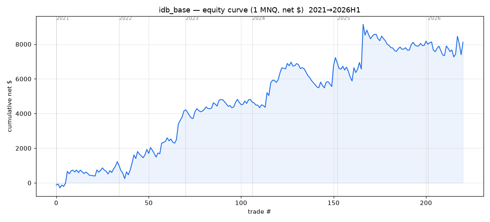

**idb drawdown**
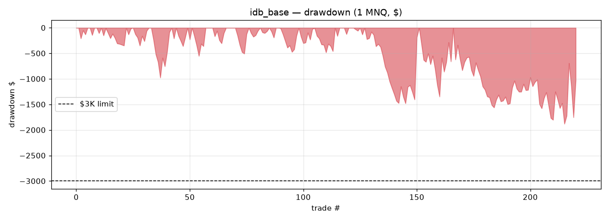

**swd equity curve**
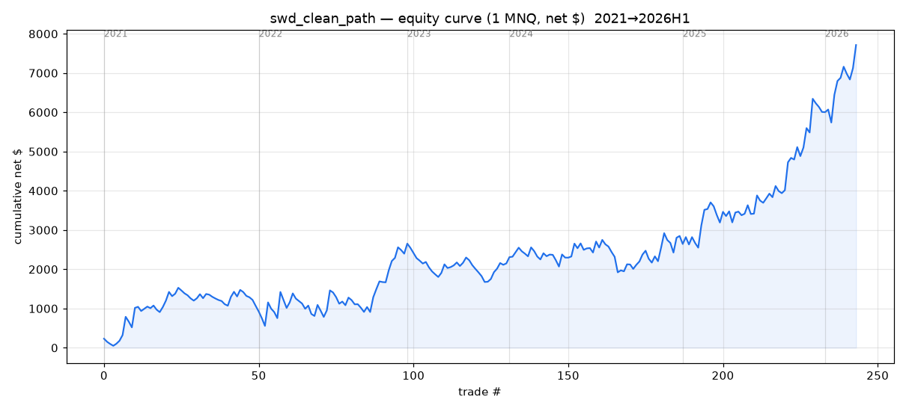

**swd drawdown**
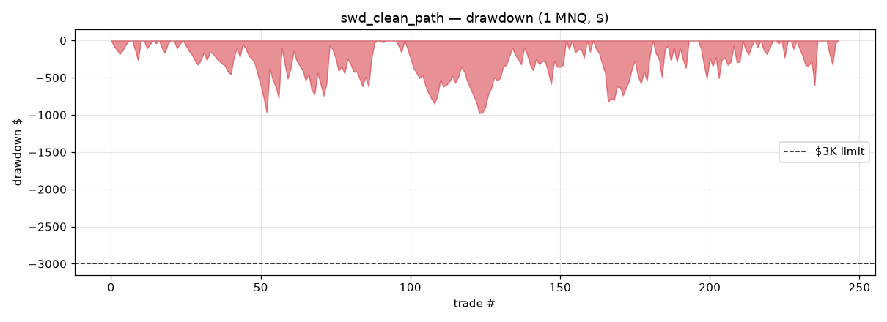

**portfolio equity curve**
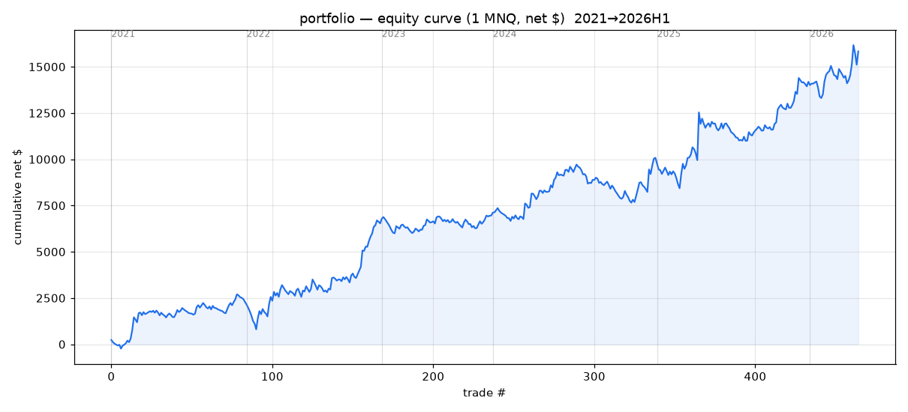

**portfolio drawdown**
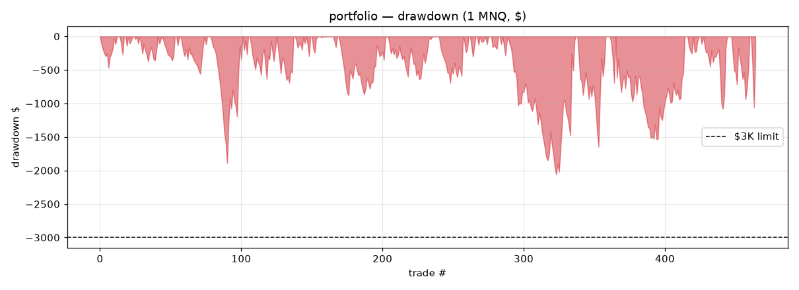

**monthly PnL (all)**
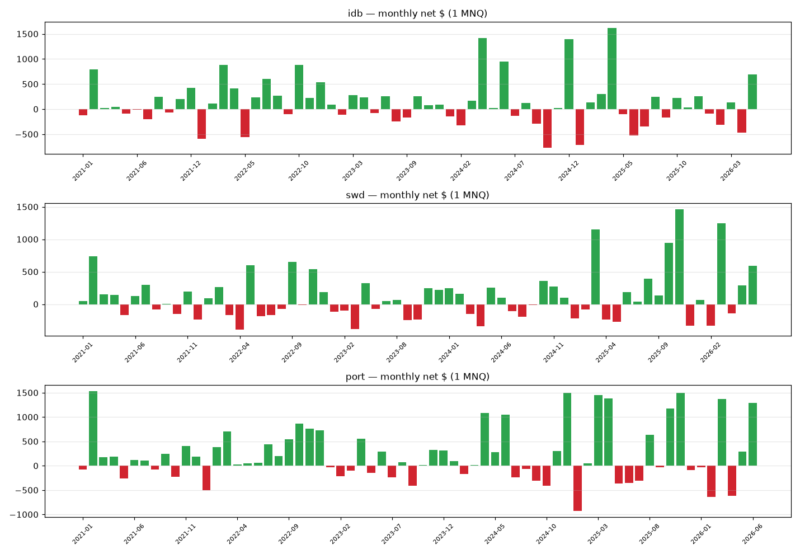

**yearly PnL**
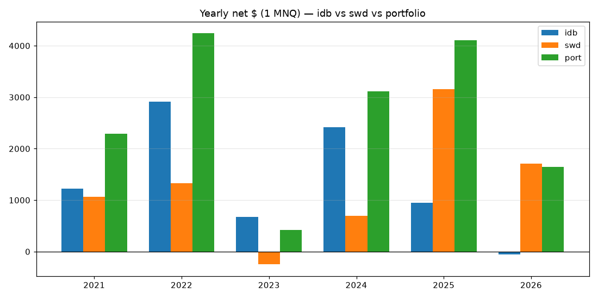

**rolling 20-trade expectancy / 50-trade PF / drawdown**
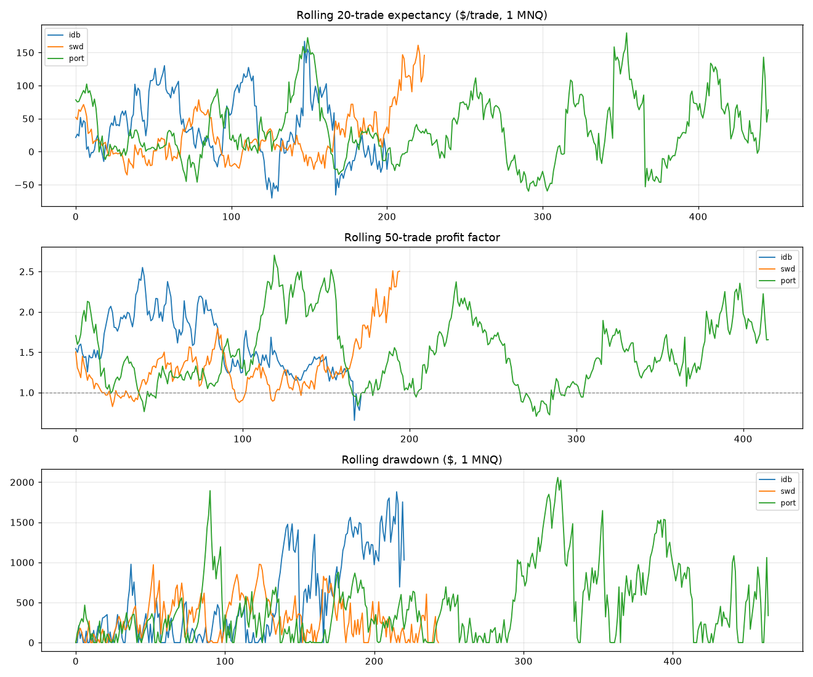

**trade R distribution**
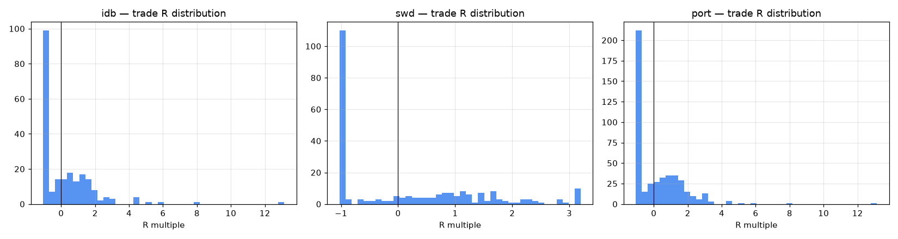

**portfolio win/loss streaks**
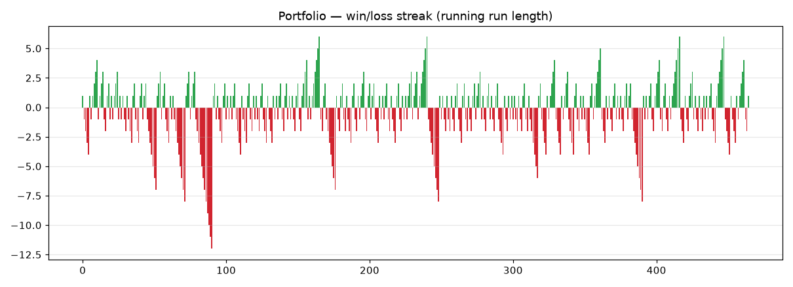

## Part 8 — Exports
- `phase30_finalists_exact_stats.csv` — one row per finalist, all summary stats
- `phase30_finalist_trades.csv` — every trade (prices, R, MFE/MAE, costs, equity/DD after trade)
- `phase30_100k_account_sim.csv` — all 100K feasibility sims (3 models × sizings)
- `phase30_monte_carlo.csv` — Monte Carlo results
- `phase30_monthly_detail.csv` — per-finalist monthly pnl/trades/win%/PF/maxDD
- this report: `phase30_finalist_report.md` + 11 PNGs

## Part 9 — Final answers (exact)
1. **Trade count:** idb **221**, swd **244**, portfolio **465** (same-day EOD-flat trades, 2021→2026-H1).
2. **RR:** all **dynamic** (idb = hold-to-EOD, swd = target prior POC). Realized avg R (net): idb **0.229**, swd **0.131**, port **0.177**; avg win 1.356R / avg loss -0.908R (swd).
3. **Max drawdown (1 MNQ):** closed-trade — idb **$1880**, swd **$977**, portfolio **$2059**.
4. **Closed-trade or intraday?** Reported both. Closed-trade above; intraday (MFE/MAE-aware) is slightly higher: idb $1,933 · swd $1,223 · portfolio $2,145.
5. **Survive 100K / $3K?** At **1 MNQ, yes** on closed+intraday history (all pass trailing). But Monte Carlo says only **swd is comfortably safe** (p99 maxDD $2,969); idb & portfolio are **marginal** (expected reshuffle maxDD ~$3,165). At **2 MNQ**: idb & portfolio FAIL trailing; swd passes history but is risky (month-boot breach 36%). 5 MNQ / 1 NQ: fail (except under the lenient locked model).
6. **Safest sizing:** **swd_clean_path at 1 MNQ** (lowest DD, p99 < $3K). For idb/portfolio, 1 MNQ is the max and is still marginal for a $3K *trailing* limit.
7. **Best strategy:** **swd** for a tight $3K account (highest PF 1.535, ret/DD 7.9, lowest DD, safest MC). **Portfolio** for robustness (profitable all 6 years, 2× the $) but needs a larger DD buffer (~$4–5K) or the locked model. **idb** is the weakest standalone for a $3K limit (deep, order-dependent DD).
8. **Forward paper ready?** **Yes** — swd 1 MNQ and the portfolio are worth forward-paper.
9. **Live ready?** **No** — PF ~1.5 (not ≥2), DD risk is order-dependent (MC), 2026 is partial, and the strict grid walk-forward was weak. Forward-paper first.
10. **Next best step:** forward-paper **swd 1 MNQ** (primary) and the **portfolio on a ≥$5K-DD or locked account**; then build 1m/3m bars for 2025-H2→2026 to test the finalists on faster timeframes, and add a third uncorrelated sleeve to cut the order-dependent DD.
