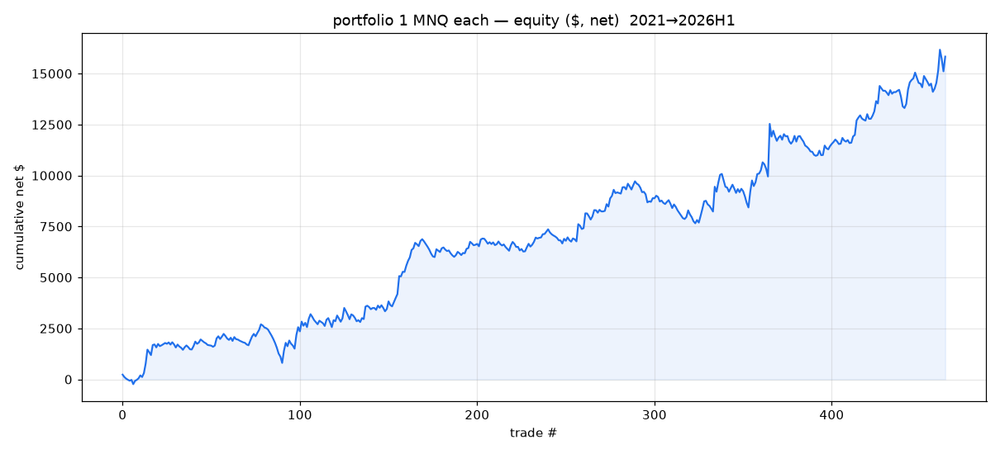
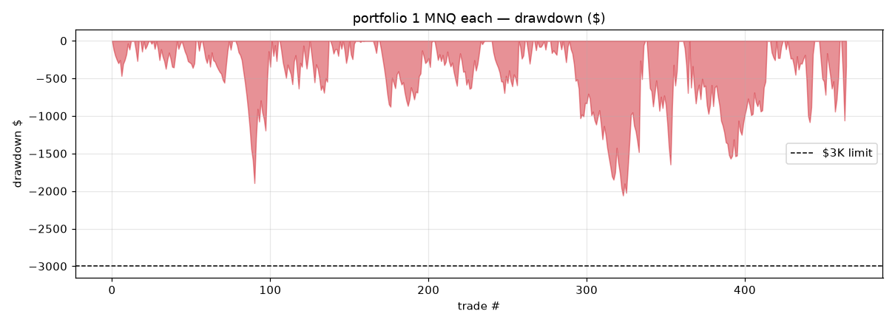
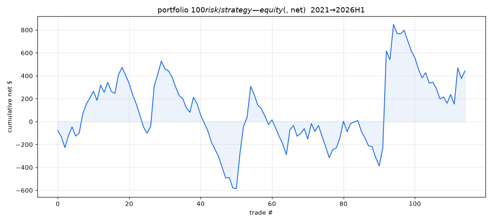
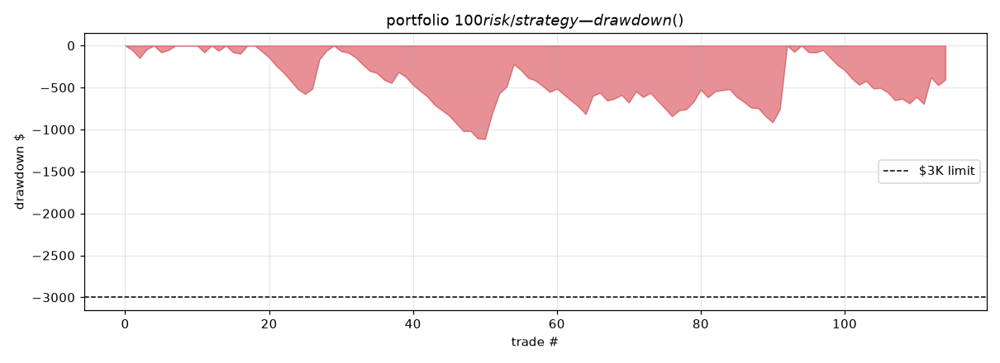
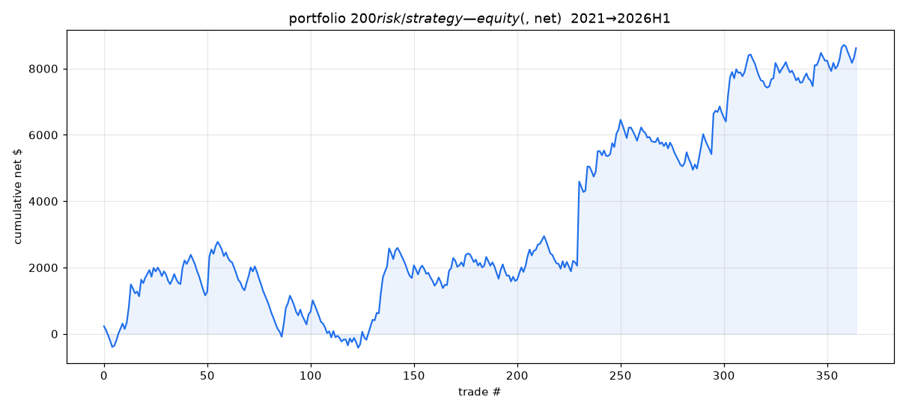
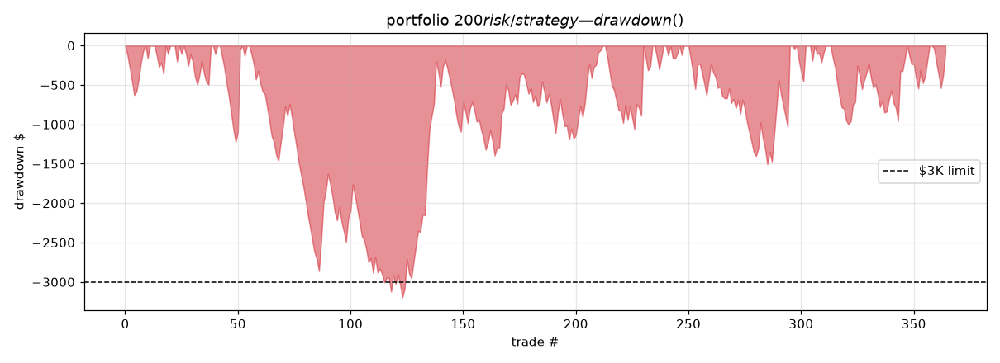
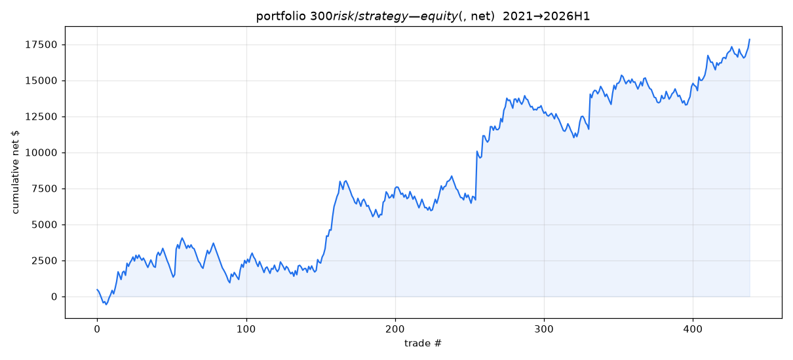
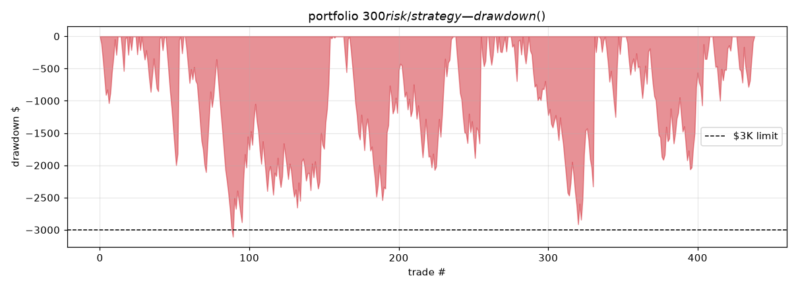
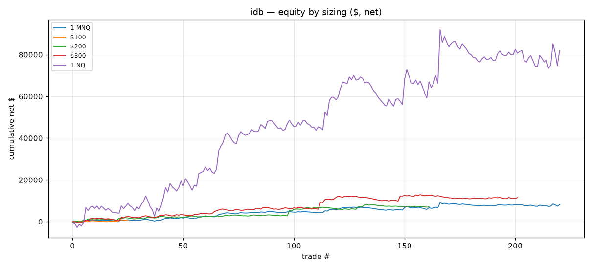
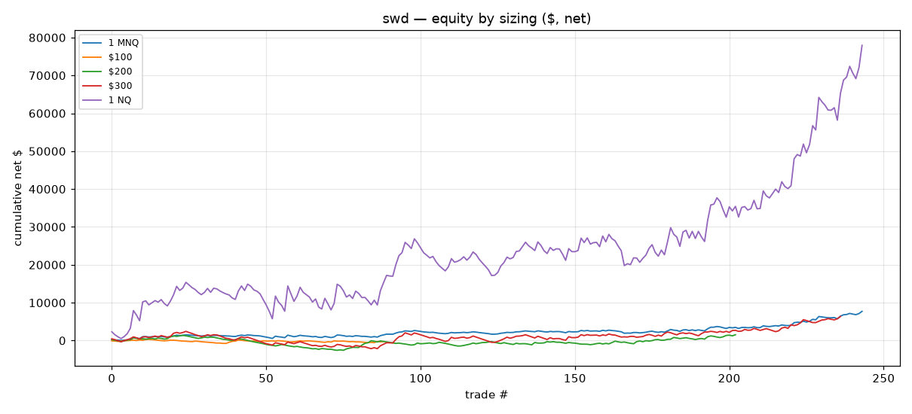

# Phase 30 Finalist — Fixed-Dollar-Risk Sizing Study

> **Frozen strategies, sizing-only change.** Same finalists as the Phase-30 deep-dive (idb 221, swd 244, portfolio 465 base trades); only the position-sizing simulation differs. Fixed-$ risk is **dynamic**: `contracts = floor(risk_budget / (stop_distance_pts × $2))`, skip if < 1, net scales linearly with contracts (costs included). 1 NQ uses $20/pt + $1.70 RT commission. Account = $100,000 with a **$3,000 trailing** max drawdown (`floor = peak − 3000`, intratrade lows via MAE).

**The one-line finding:** fixed-$ risk **improves idb** (normalizes risk, skips the widest-stop trades) but **breaks swd** (it over-sizes low-volatility / tight-stop trades — exactly where swd's edge is weakest). swd's correct sizing is **fixed contracts**, not fixed-$ risk. Small budgets ($50–$100) skip most trades because the 2.5×ATR stops cost ~$130–175 risk per MNQ.

## Part 1 — Sizing comparison (per finalist + portfolio)
### idb_base | RTH | eod
| sizing | trades | skipped | avgC | maxC | avg $risk | net $ | PF | win% | maxDD $ | intraday DD $ | ret/DD | Sharpe | maxLstreak | worst-20 | prof yrs | **$3K fail?** | buffer $ |
|---|---|---|---|---|---|---|---|---|---|---|---|---|---|---|---|---|---|
| 1 MNQ | 221 | 0 | 1.0 | 1 | 173.38 | 8120.16 | 1.439 | 45% | 1880.23 | 1932.54 | 4.319 | 2.554 | 9 | -1405.95 | 5 | ✅ ok | 1067.46 |
| $50 | 7 | 214 | 1.57 | 3 | 40.95 | -172.32 | 0.198 | 14% | 214.82 | 214.55 | -0.802 | -10.159 | 6 | -172.32 | 0 | ✅ ok | 2785.45 |
| $100 | 26 | 195 | 1.65 | 6 | 79.72 | 706.41 | 1.656 | 42% | 454.79 | 493.79 | 1.553 | 2.28 | 6 | 91.66 | 3 | ✅ ok | 2506.21 |
| $150 | 108 | 113 | 1.36 | 9 | 124.88 | 4114.98 | 1.621 | 44% | 968.18 | 1084.18 | 4.25 | 2.846 | 7 | -402.57 | 5 | ✅ ok | 1915.82 |
| $200 | 162 | 59 | 1.43 | 13 | 150.18 | 7081.8 | 1.62 | 44% | 1247.05 | 1335.02 | 5.679 | 2.709 | 7 | -900.29 | 5 | ✅ ok | 1664.98 |
| $250 | 193 | 28 | 1.67 | 16 | 189.49 | 9139.7 | 1.531 | 46% | 1853.04 | 1980.96 | 4.932 | 2.815 | 9 | -1778.5 | 5 | ✅ ok | 1019.04 |
| $300 | 202 | 19 | 2.0 | 19 | 230.91 | 11488.7 | 1.518 | 45% | 2420.39 | 2652.39 | 4.747 | 2.589 | 9 | -2347.0 | 5 | ✅ ok | 347.61 |
| 1 NQ | 221 | 0 | 1.0 | 1 | 1733.78 | 81930.91 | 1.444 | 46% | 18640.62 | 19166.96 | 4.395 | 2.577 | 9 | -13993.46 | 5 | ❌ FAIL | -16166.96 |

### swd_clean_path | RTH | toPOC
| sizing | trades | skipped | avgC | maxC | avg $risk | net $ | PF | win% | maxDD $ | intraday DD $ | ret/DD | Sharpe | maxLstreak | worst-20 | prof yrs | **$3K fail?** | buffer $ |
|---|---|---|---|---|---|---|---|---|---|---|---|---|---|---|---|---|---|
| 1 MNQ | 244 | 0 | 1.0 | 1 | 132.73 | 7713.77 | 1.535 | 46% | 977.21 | 1222.7 | 7.894 | 2.667 | 8 | -705.77 | 5 | ✅ ok | 1777.3 |
| $50 | 11 | 233 | 1.0 | 1 | 43.01 | -185.64 | 0.454 | 27% | 218.0 | 322.82 | -0.852 | -7.399 | 5 | -185.64 | 0 | ✅ ok | 2677.18 |
| $100 | 89 | 155 | 1.12 | 2 | 78.83 | -264.14 | 0.934 | 38% | 1066.7 | 1119.2 | -0.248 | -0.458 | 7 | -831.07 | 2 | ✅ ok | 1880.8 |
| $150 | 172 | 72 | 1.33 | 4 | 115.63 | -611.77 | 0.945 | 42% | 2573.34 | 2623.84 | -0.238 | -0.41 | 8 | -1589.93 | 3 | ✅ ok | 376.16 |
| $200 | 203 | 41 | 1.64 | 5 | 149.88 | 1534.12 | 1.095 | 43% | 3958.16 | 4008.66 | 0.388 | 0.627 | 12 | -2280.48 | 4 | ❌ FAIL | -1008.66 |
| $250 | 227 | 17 | 2.05 | 7 | 198.44 | 4053.71 | 1.178 | 44% | 4427.27 | 4474.73 | 0.916 | 1.164 | 11 | -2573.73 | 4 | ❌ FAIL | -1474.73 |
| $300 | 237 | 7 | 2.46 | 8 | 243.11 | 6342.02 | 1.219 | 46% | 4559.46 | 4660.46 | 1.391 | 1.392 | 8 | -2525.23 | 4 | ❌ FAIL | -1660.46 |
| 1 NQ | 244 | 0 | 1.0 | 1 | 1327.26 | 77942.88 | 1.543 | 46% | 9689.64 | 12134.56 | 8.044 | 2.695 | 8 | -6991.68 | 5 | ❌ FAIL | -9134.56 |

### portfolio (idb + swd)
| sizing | trades | skipped | avgC | maxC | avg $risk | net $ | PF | win% | maxDD $ | intraday DD $ | ret/DD | Sharpe | maxLstreak | worst-20 | prof yrs | **$3K fail?** | buffer $ |
|---|---|---|---|---|---|---|---|---|---|---|---|---|---|---|---|---|---|
| 1 MNQ each | 465 | 0 | 1.0 | 1 | 152.05 | 15833.93 | 1.481 | 46% | 2059.21 | 2145.32 | 7.689 | 2.627 | 12 | -1199.02 | 6 | ✅ ok | 854.68 |
| $200/strategy | 365 | 0 | 1.54 | 13 | 150.02 | 8615.93 | 1.313 | 44% | 3195.04 | 3290.54 | 2.697 | 1.725 | 13 | -1679.12 | 6 | ❌ FAIL | -290.54 |
| $200 total/day | 288 | 177 | 1.5 | 13 | 146.65 | 4908.63 | 1.22 | 43% | 1955.62 | 1977.12 | 2.51 | 1.266 | 10 | -1525.95 | 5 | ✅ ok | 1022.88 |
| $300 total/day | 337 | 128 | 2.21 | 19 | 235.35 | 7945.82 | 1.19 | 43% | 3107.54 | 3210.25 | 2.557 | 1.143 | 10 | -1906.04 | 5 | ❌ FAIL | -210.25 |
| $500 total/day | 355 | 110 | 3.82 | 33 | 418.48 | 14521.5 | 1.185 | 44% | 5371.48 | 5427.77 | 2.703 | 1.142 | 10 | -3449.0 | 5 | ❌ FAIL | -2427.77 |

## Part 2 — 100K / $3,000 (trailing) drawdown results
Pass/fail, drawdowns, buffer and breach date per sizing are in the Part-1 tables (last 4 columns) and `phase30_sizing_comparison.csv`. Summary of what survives:

| sizing | idb | swd | portfolio |
|---|:--:|:--:|:--:|
| 1 MNQ | ✅ DD $1880.23 | ✅ DD $977.21 | — |
| $100 | ✅ DD $454.79 | ✅ DD $1066.7 | — |
| $150 | ✅ DD $968.18 | ✅ DD $2573.34 | — |
| $200 | ✅ DD $1247.05 | ❌ DD $3958.16 | — |
| $250 | ✅ DD $1853.04 | ❌ DD $4427.27 | — |
| $300 | ✅ DD $2420.39 | ❌ DD $4559.46 | — |
| 1 NQ | ❌ DD $18640.62 | ❌ DD $9689.64 | — |
| 1 MNQ each | — | — | ✅ DD $2059 |
| $200/strategy | — | — | ❌ DD $3195 |
| $200 total/day | — | — | ✅ DD $1956 |
| $300 total/day | — | — | ❌ DD $3108 |
| $500 total/day | — | — | ❌ DD $5371 |

**Maximum safe risk per trade** (largest budget with no historical $3K breach / with Monte-Carlo p99 max-DD < $3K):

| | historical max-safe | MC-robust (p99<$3K) | recommended |
|---|--:|--:|---|
| idb (fixed-$ MNQ) | $375 | $150 | **$150/trade** (PF 1.62, DD $968, MC p99 $2,428) |
| swd (fixed-$ MNQ) | $150 | $125 | **don't use fixed-$** — use fixed 1 MNQ (DD $977) or 2 MNQ |
| portfolio (total/day) | $250 | $100 | **1 MNQ each** or ≤$200 total/day |

## Part 3 — Monte Carlo / risk of ruin (2,000 sims; reshuffle + slippage stress, intratrade MAE)
### idb
| sizing | P(DD≥3K) | P(DD≥2.5K) | P(DD≥2K) | exp maxDD | p95 | p99 | P(profit 60d) | P(profit 120d) |
|---|--:|--:|--:|--:|--:|--:|--:|--:|
| 1 MNQ | 1.0 | 1.0 | 1.0 | $3161.02 | $3875.21 | $4571.53 | 0.905 | 0.965 |
| $50 | 0.0 | 0.0 | 0.0 | $196.91 | $228.53 | $236.81 | 0.0 | 0.0 |
| $100 | 0.0 | 0.0 | 0.0 | $845.71 | $845.48 | $845.57 | 0.881 | 0.9515 |
| $150 | 0.0005 | 0.0085 | 0.051 | $1731.58 | $2009.18 | $2428.09 | 0.93 | 0.9825 |
| $200 | 0.0135 | 1.0 | 1.0 | $2554.12 | $2573.37 | $3049.12 | 0.9105 | 0.98 |
| $250 | 0.118 | 1.0 | 1.0 | $2674.22 | $3407.26 | $3995.33 | 0.931 | 0.9785 |
| $300 | 1.0 | 1.0 | 1.0 | $3568.62 | $4526.42 | $5448.87 | 0.9015 | 0.966 |
| 1 NQ | 1.0 | 1.0 | 1.0 | $31492.05 | $37921.64 | $46976.41 | 0.912 | 0.971 |

### swd
| sizing | P(DD≥3K) | P(DD≥2.5K) | P(DD≥2K) | exp maxDD | p95 | p99 | P(profit 60d) | P(profit 120d) |
|---|--:|--:|--:|--:|--:|--:|--:|--:|
| 1 MNQ | 0.006 | 0.047 | 0.194 | $1662.04 | $2476.86 | $2875.18 | 0.898 | 0.969 |
| $50 | 0.0 | 0.0 | 0.0 | $280.83 | $370.92 | $417.23 | 0.0 | 0.0 |
| $100 | 0.0 | 0.0 | 0.009 | $1191.13 | $1704.24 | $1982.4 | 0.413 | 0.3815 |
| $150 | 0.1155 | 0.3345 | 0.699 | $2330.23 | $3303.12 | $3773.57 | 0.4125 | 0.364 |
| $200 | 0.2415 | 0.5055 | 0.7975 | $2575.37 | $3776.57 | $4509.56 | 0.602 | 0.661 |
| $250 | 0.462 | 0.752 | 0.9415 | $3064.15 | $4613.94 | $5455.11 | 0.711 | 0.7985 |
| $300 | 0.703 | 0.9085 | 0.994 | $3613.45 | $5413.4 | $6612.86 | 0.7455 | 0.8255 |
| 1 NQ | 1.0 | 1.0 | 1.0 | $16297.95 | $24023.53 | $28293.95 | 0.9095 | 0.9685 |

### portfolio
| sizing | P(DD≥3K) | P(DD≥2.5K) | P(DD≥2K) | exp maxDD | p95 | p99 | P(profit 60d) | P(profit 120d) |
|---|--:|--:|--:|--:|--:|--:|--:|--:|
| 1 MNQ each | 1.0 | 1.0 | 1.0 | $3162.21 | $3846.16 | $4674.06 | 0.9075 | 0.974 |
| $200/strategy | 0.283 | 1.0 | 1.0 | $2885.74 | $4067.97 | $4864.89 | 0.795 | 0.879 |
| $200 total/day | 0.269 | 0.516 | 0.83 | $2641.82 | $3918.1 | $4993.05 | 0.7265 | 0.8075 |
| $300 total/day | 0.93 | 0.995 | 1.0 | $4464.49 | $6676.74 | $7996.2 | 0.711 | 0.7635 |
| $500 total/day | 1.0 | 1.0 | 1.0 | $8077.97 | $12219.82 | $14201.83 | 0.708 | 0.783 |

> Note: $50/$100 budgets skip so many trades that 60-day windows often contain *zero* trades (P(profit)→low) — they are not viable, not safe. idb $150–$200 is the genuinely robust fixed-$ zone; swd is robust only as fixed 1 MNQ.

## Part 4 — Graphs by sizing
**portfolio — 1 MNQ each (equity)**

**portfolio — 1 MNQ each (drawdown)**

**portfolio — $100 risk/strategy (equity)**

**portfolio — $100 risk/strategy (drawdown)**

**portfolio — $200 risk/strategy (equity)**

**portfolio — $200 risk/strategy (drawdown)**

**portfolio — $300 risk/strategy (equity)**

**portfolio — $300 risk/strategy (drawdown)**

**idb — equity by sizing (1 MNQ vs $100/$200/$300 vs 1 NQ)**

**swd — equity by sizing**

## Part 5 — Final answers (exact)
1. **Why 1 MNQ only in Phase 30?** To compare strategies on an equal, **sizing-invariant** footing — PF, win-rate and drawdown are identical regardless of contract count, and $ scales linearly. It was a measurement choice, never a position-sizing recommendation.
2. **What changes with fixed $200 risk?** Contracts become dynamic (≈1–2 typical, up to 13–16 on very tight stops). **idb improves** (PF 1.44→**1.62**, maxDD $1,880→**$1,247**, net $7,082 on 162 trades, 59 wide-stop trades skipped). **swd breaks** (PF 1.535→**1.10**, maxDD $977→**$3,958 — FAILS $3K**) because fixed-$ over-sizes low-vol/tight-stop trades where swd is weak. Portfolio $200/strategy FAILS (DD $3,195).
3. **Is fixed $200 safe on 100K/$3K?** **Only for idb, and only borderline** (historical DD $1,247, buffer $1,665, but MC p99 = $3,049 — just over). **Not safe for swd** or the **$200/strategy portfolio** (both fail). So $200 fixed-risk is **not** a safe portfolio-wide rule.
4. **Max safe risk per trade?** idb: historical $375, MC-robust $150 → **recommend $150** (PF 1.62, DD $968, p99 $2,428). swd: fixed-$ is unsafe → **use fixed 1 MNQ** (DD $977) — 2 MNQ also passes. Portfolio: **≤$200 total/day** (DD $1,956) or 1 MNQ each; historical max-safe total $250.
5. **Is 1 NQ safe?** **No — far too large.** 1 NQ ≈ 10× MNQ: idb DD **$18,641**, swd **$9,690**, both breach $3K by a wide margin. 1 NQ needs roughly a $20K+ account, not $3K.
6. **Is the portfolio safer than either alone?** Not in raw drawdown — at 1 MNQ each the portfolio DD ($2,059) is **higher** than swd alone ($977) because two positions run concurrently. Its advantage is **stability** (profitable all 6 years, smoother) — not a smaller drawdown. For pure $3K-survival, **swd alone at 1 MNQ is the safest** single choice.
7. **Forward-paper sizing:** **portfolio 1 MNQ each** (diversified, survives $3K, DD $2,059) — or, to use the budget better, **idb @ $150 fixed-risk + swd @ 1 (or 2) fixed MNQ**.
8. **Too aggressive:** swd with fixed-$ risk (any budget ≥$150), any sizing ≥$250 fixed-risk, $300+ total/day portfolio, 2+ MNQ on idb/portfolio, and **1 NQ** anything.
9. **Trade count & drawdown per sizing (1 MNQ baseline):**
   - idb: 1 MNQ → 221 trades / $1,880 DD; $150 → 108 / $968; $200 → 162 / $1,247; $300 → 202 / $2,420; 1 NQ → 221 / $18,641.
   - swd: 1 MNQ → 244 / $977; $150 → 172 / $2,573; $200 → 203 / $3,958 (fail); 1 NQ → 244 / $9,690.
   - portfolio: 1 MNQ each → 465 / $2,059; $200/strat → 365 / $3,195 (fail); $200 total/day → 288 / $1,956; $500 total/day → 355 / $5,371 (fail).
10. **Live / forward / reject?** **Forward-paper** (not live). Edge is real but modest (PF ~1.5), drawdown is order-dependent (Monte Carlo), and 2026 is partial. Recommended forward-paper config: **portfolio 1 MNQ each**, or **idb @ $150 risk + swd @ 1 MNQ**, on the 100K/$3K account.
